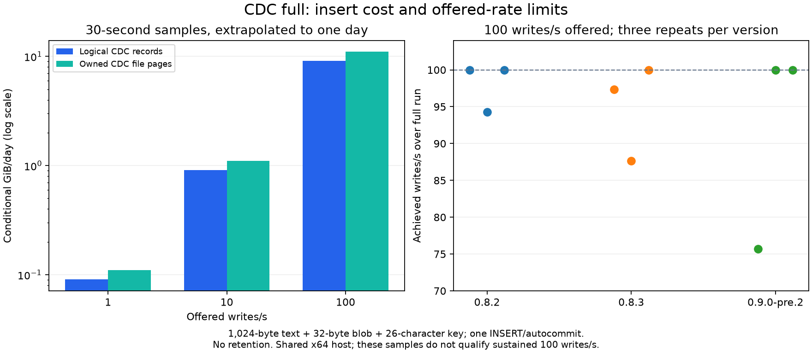

# Turso pin and CDC full qualification — 2026-10-29

**DECISION: retain Turso 0.8.2, source commit `5c168be5ef6a32ac966daf5983502a4f694b37ad`, with the existing TerraScale patches.** Reason: 0.8.3's required Fast exits are `0 / 2 / 0`, and 0.9.0-pre.2 cannot apply the current native/managed patch queues. No candidate clears the upgrade gate. CDC `full` source capture passes the tested checkpoint, DDL, trigger and restart cases on all three versions; it supplies no reason to bypass those gates. MVCC stays excluded. This report closes the qualification work for PIVOT W0-3/W0-5; it does not authorize an upgrade.

## Provenance and scope

The baseline is TerraScale `4bacd8a818cff3fab76f3f0558bdc4585361e617`, including its vendored driver patches and custom FTS/encryption native library. This change does not update the vendored driver, native source pin, storage format, or production configuration.

GitHub's tag references below are annotated tag objects. Dereferencing each object gives the source commit used for qualification; the tag-object SHA is not the source-commit SHA.

| Version | Annotated tag object | Source commit |
|---|---|---|
| 0.8.2, baseline | `5d68fe09c36149d395cbf870bf5c25b2e5970157` | `5c168be5ef6a32ac966daf5983502a4f694b37ad` |
| 0.8.3 | `29ab7747f979722eedde051301cdf2cacb53a8b4` | `607bff9fd0e547a25a97b3bf06e83bcc5d99d53c` |
| 0.9.0-pre.2 | `d12d3b0f8a7072f1e5a5010342422b83b972fb0a` | `725781518e8d2063046a8894aeec95ffa493f88b` |

Sources: [baseline pin](../../src/vendor/Turso.Data.Sqlite/UPSTREAM.md), [0.8.3 release](https://github.com/tursodatabase/turso/releases/tag/v0.8.3), [0.9.0-pre.2 release](https://github.com/tursodatabase/turso/releases/tag/v0.9.0-pre.2), and GitHub's `git/ref/tags/<tag>` followed by `git/tags/<object-sha>` APIs. Release `target_commitish` is cross-checked against the dereferenced tag.

Qualification separates official CLI/JS engine observations from compatibility of TerraScale's patched .NET binding and native build. Passing one does not establish the other. Each workload uses fresh synthetic databases, and each table reports three repeats separately. Process restart tests do not prove power-loss durability. Rate-based daily CDC growth is an extrapolation from the stated observation window, payload, and transaction shape, not an observed 24-hour soak.

MVCC remains excluded under PIVOT D11. Neither an upstream MVCC fix nor a successful isolated probe qualifies MVCC for TerraScale.

## Spike results

The [appendices and reproduction sources](../turso-qualification/appendices.tar.gz) include `benchmark/bench/2026-10-29-turso-qualification-spikes.md`, with all three-repeat tables, exact artifacts, transaction shapes and limitations. The [spike evidence archive](../turso-qualification/spikes/evidence.tar.gz) preserves the original spike markdown, extracted harnesses, dependency locks, wire images, individual samples and a 552-file SHA-256 manifest. Archive SHA-256: `cee81645ccd6d7ea02492d74c8b41fc799a566d682cce8f9832464a71058a3ee`.

| Measured property | 0.8.2 | 0.8.3 | 0.9.0-pre.2 |
|---|---|---|---|
| 100k DML, constraints, transaction/rollback, ALTER/default and index parity | PASS 3/3 | PASS 3/3 | PASS 3/3 |
| Replica and home SIGKILL recovery on separate fresh files | PASS 3/3 | PASS 3/3 | PASS 3/3 |
| Existing page-pull replica sees acknowledged post-TRUNCATE-checkpoint insert | FAIL 3/3 | FAIL 3/3 | FAIL 3/3 |
| Reopening the same replica repairs that checkpoint mismatch | FAIL 3/3 | FAIL 3/3 | FAIL 3/3 |
| Failed UNIQUE push is atomic | FAIL 3/3 | FAIL 3/3 | FAIL 3/3 |
| Original table-rebuild push preserves the table | FAIL 3/3 | FAIL 3/3 | FAIL 3/3 |
| Original MVCC bootstrap probe produces a usable replica | FAIL 3/3 | FAIL 3/3 | FAIL 3/3 |
| Single INSERT-trigger reproducer, home audit rows in repeats 1/2/3 | 2 / 2 / 2 | 2 / 2 / 2 | 1 / 1 / 1 |

The prerelease trigger outcome reflects a changed replay order: both base and audit images still exist, but the base insert fires the home trigger before the pushed audit upsert arrives. It does not establish general exactly-once trigger replay. Disjoint-column merges and a 60-second distinct-key partition converge in 3/3 repeats per version; stale same-column updates, arithmetic lost intent, integer-key collisions, FK ordering, and blocked conflict replay remain observed limitations.

All 54 lag runs retained every measured row. At 70 ms client–home RTT, prerelease single-row 100 writes/s repeats achieved `88.5 / 100.0 / 81.8` writes/s and p99 `5600.1 / 2568.1 / 3027.7` ms. The corresponding 0.8.3 repeats achieved `100.1 / 100.2 / 100.2` writes/s with p99 `597.8 / 613.4 / 589.0` ms. This is a deterioration in these shared-host runs; its cause is unresolved. The detailed report retains the other RTTs, the separate 1,000 rows/s ten-row transaction workload, and every outlier. No production throughput or sub-200 ms cross-region claim follows.

## Upstream changes to assess

[0.8.2 → 0.8.3](https://github.com/tursodatabase/turso/compare/v0.8.2...v0.8.3) contains 14 commits. Its correctness fixes concern logical-MVCC schema ordering, switching journal mode inside a transaction, repeated indexed seeks, AUTOINCREMENT, nested sequence commits, concurrent B-tree deletion, logical-log checkpointing, transaction GC, and logical-log header publication. These are source changes, not evidence that WAL CDC, checkpoint revisions, trigger replay, or failed push atomicity are fixed.

[0.8.3 → 0.9.0-pre.2](https://github.com/tursodatabase/turso/compare/v0.8.3...v0.9.0-pre.2) contains 1,614 commits. A first-page GitHub compare response is incomplete for this range; no claim of a complete bug inventory follows from it. Runtime results and the binding/native compatibility gates determine the recommendation.

The original spike's upstream reports [trigger duplication #10147](https://github.com/tursodatabase/turso/issues/10147), [failed push partial apply #10178](https://github.com/tursodatabase/turso/issues/10178), and [blocked pull replay #10180](https://github.com/tursodatabase/turso/issues/10180) were still open when checked on 2026-10-29. A reproducer ceasing to show a symptom is narrower evidence than a general fix for an issue. PIVOT D14 continues to exclude upstream push/server-side apply regardless of this comparison.

## CDC qualification

The real-file CDC harness uses official `@tursodatabase/database` packages matching each candidate. A Node worker owns the database; its controller compares raw SQLite-record before/after images, including negative integers, NULL, Unicode text, and binary bytes. Committed multi-statement transactions have one commit marker and a common transaction ID; rollback must leave both application rows and the CDC stream unchanged. These are engine observations, separate from the patched TerraScale integration gate.

The archived appendix `benchmark/bench/2026-10-29-turso-qualification-cdc.md` and [raw records](../turso-qualification/cdc/results.json) retain all nine strengthened correctness probes and 54 paired growth/control records. Every correctness check below passed in all three repeats of each version:

| Full-mode source-capture assertion | 0.8.2 | 0.8.3 | 0.9.0-pre.2 |
|---|---|---|---|
| Exact INSERT/UPDATE/DELETE and AFTER UPDATE audit images, NULL/blob/Unicode | PASS 3/3 | PASS 3/3 | PASS 3/3 |
| Commit markers and rollback leave the expected stream | PASS 3/3 | PASS 3/3 | PASS 3/3 |
| TRUNCATE checkpoint retains old records and captures a fresh insert | PASS 3/3 | PASS 3/3 | PASS 3/3 |
| ADD COLUMN default and complete five-column UPDATE images | PASS 3/3 | PASS 3/3 | PASS 3/3 |
| CREATE INDEX; old stream prefix unchanged through both DDLs | PASS 3/3 | PASS 3/3 | PASS 3/3 |
| SIGKILL/reopen: retained records and complete continued UPDATE images | PASS 3/3 | PASS 3/3 | PASS 3/3 |

All probes observed WAL mode, checkpoint `busy=0, log=0, checkpointed=0` after truncation, and SIGKILL exit `-9`. Successful CDC source capture across ALTER does not contradict the earlier prototype's deliberate refusal to replay schema changes. These assertions cover one AFTER UPDATE trigger and process crashes; they do not establish arbitrary trigger replay or power-loss durability.

## CDC storage cost

Each 30-second sample inserts a 26-character synthetic key, 1,024 text bytes and a 32-byte blob, one autocommit per INSERT. Each rate/version has three full-capture runs paired with independent no-capture controls. The checkpointed file's CDC-owned B-tree/overflow page growth and its logical record payload are measured separately; application table/index pages and current WAL lengths are reported separately in the detailed note. One insert emits one row record and one commit marker. No retention or trimming runs.

| Offered writes/s | Writes per repeat | Logical CDC bytes/write | Owned CDC page bytes/write | Conditional logical GiB/day | Conditional CDC pages GiB/day |
|---:|---:|---:|---:|---:|---:|
| 1 | 30 | 1,124.900 | 1,365.333 | 0.090517 | 0.109863 |
| 10 | 300 | 1,127.140 | 1,365.333 | 0.906968 | 1.098633 |
| 100 | 3,000 | 1,127.914 | 1,368.064 | 9.075903 | 11.008301 |

For each rate, the cost values match across all nine independent runs (three versions × three repeats). Daily columns are `measured bytes/write × offered writes/s × 86,400 / 2^30`; short samples have 4 KiB page quantization. These are insert-only conditional extrapolations, not observed daily growth, filesystem block allocation, write amplification, or a mixed UPDATE/DELETE workload estimate.



The detailed timing table preserves every rate miss. At 100 offered writes/s, the slowest full-capture repeats achieved 94.283/s on 0.8.2, 87.625/s on 0.8.3, and 75.693/s on pre.2. Other runs finished near 30 seconds but accumulated scheduling lag. Sustained 100 writes/s capacity remains unqualified; the growth extrapolation assumes that offered throughput can be sustained. This shared-host study does not isolate the cause of overruns. Automatic checkpoints remain in effect, so observed WAL file lengths must not be extrapolated linearly into daily WAL capacity.

The chart is generated from the committed JSON by `nice -n 19 uv run --with matplotlib==3.11.2 python benchmark/turso-qualification/plot.py`. Its first panel shows the identical per-rate cost values across versions; its second retains all nine 100/s full-capture rate observations.

## TerraScale binding and existing-suite gate

The archived appendix `benchmark/bench/2026-10-29-turso-qualification-integration.md`, [summary JSON](../turso-qualification/integration/summary.json), and [integration evidence](../turso-qualification/integration/evidence.tar.gz) record every attempt. The 0.8.3 native-source and managed patch queues apply in 3/3 pristine attempts. The prerelease rejects `turso-native-budget.patch` in two FTS files and conflicts in `0006-fix-turso-read-declared-types-from-native-column-met.patch` in 3/3 attempts; later patches, its native build, and its TerraBase suites remain unqualified.

The successful custom 0.8.3 x64 native build retains the pinned Rust 1.88.0 container, locked Cargo graph, native patch contracts, FTS budgeting, and runtime-dispatched C AEGIS. FTS/encryption/contract smokes and crypto auditing passed. Its SHA-256 is `15d7541e62ddaf99cd821e2780e0bdbed0858b2ec7e8db96a299249d744f5a5d`, versus baseline `7464a29f3fc9bce603a1e0881720b309a276455a778937d6a9ffc2ed680bd76d`. Runtime process mappings confirm the tested hashes; both expose the same 79 `turso_*` symbols. This is one x64 build, not ARM64 execution or two-build reproducibility qualification. Initial build failures from Podman's image format and a literal smoke-version expectation are preserved, with the corrected Docker-format build and exact 0.8.3 assertion.

| Existing target, final matching environment | Baseline exits R1/R2/R3 | Custom 0.8.3 exits R1/R2/R3 | Counts |
|---|---|---|---|
| Vendor regression tests + TerraBase Fast | 0 / 0 / 0 | 0 / 2 / 0 | Vendor 44/44 every run; baseline Fast 3192/3192 every run; candidate Fast 3192 / 3191 / 3192 passed |
| TerraBase Slow, CI SDK and storage credentials | 0 / 0 / 0 | 0 / 0 / 0 | Each repeat: 89 passed, 0 failed, 1 existing child-host helper skip |

0.8.3 Fast repeat 2 fails `A_tenant_reaches_nothing_of_another_tenant_through_any_client_route`: the final own-tenant `SnapshotAsync` gets HTTP 429 (`TenantIsolationTests.cs:441`, called at line 142), after the cross-tenant denial assertions. Baseline passes all three repeats. This is not evidence of a security breach or proven engine regression, but it prevents clean three-repeat required-Fast qualification. No test or limiter was changed to hide it. Fast remains blocking; successful Slow results do not override it.

Initial Slow attempts used a mismatched sibling SDK and failed before executing tests; [#891](https://github.com/TerraScale/terrascale/issues/891) preserves them. The corrected runs use CI's SDK `2dda37f08abe7497b35dc431895960e70f3c3611`, exported into isolated scratch. Six later runs lacked storage credentials and failed three Tigris cases; [#899](https://github.com/TerraScale/terrascale/issues/899), [#900](https://github.com/TerraScale/terrascale/issues/900), and [#901](https://github.com/TerraScale/terrascale/issues/901) preserve those failures. Six credentialed reruns passed, and all four environment reports were closed with evidence. Historical failures remain in the archive and summary. The existing helper skip was not introduced or expanded.

## Reproduction, verification and remaining work

Measured hosts were shared Linux x64 dev machines: spike runs on mariogk-dev, CDC/native/suite runs on beta, at repository baseline `4bacd8a818cff3fab76f3f0558bdc4585361e617`. All heavy execution used separate `ts-heavy-any` job branches; network shaping affected only namespace loopback. These runs do not qualify OCI ARM, power failure, production capacity, or the later report commit's CI. No production source, SDK checkout, vendor pin or storage format changed.

The appendices archive contains the three detailed Markdown reports and their final reproduction/collection scripts at their original repository-relative paths. Measurement archives additionally retain the exact executed source revisions and logs, including historical setup failures. This packages research evidence without installing a new production or CI dependency. To inspect or reproduce, verify the published files, then extract the appendices into a fresh scratch directory and follow each detailed report; the spike archive also holds the two original `.cos` markdown inputs and extracted upstream issue reproducers.

```bash
cd benchmark/turso-qualification
sha256sum --check SHA256SUMS
mkdir -p /tmp/turso-qualification-review
tar -xzf appendices.tar.gz -C /tmp/turso-qualification-review
cp -a cdc integration spikes /tmp/turso-qualification-review/benchmark/turso-qualification/
```

The parent verification checked all nine SQL hashes/parity results, the spike's 552-file manifest, all nine strengthened CDC probes, the 54 growth/control records and daily arithmetic, and the integration archive's internal manifest and suite summaries. Failed or unexecuted attempts are never counted as passing. Required CI on the report's exact head remains the merge gate.

The qualification keeps the pin, rather than claiming the existing engine has no defects. PIVOT W0-2/R1 own checkpoint-safe revisions; R6/R7 own atomic apply instead of upstream push; F5 owns retention tied to shape and backup floors. Before any later pin change, resolve the required-Fast failure's cause, port incompatible patches where necessary, rerun the qualification gates, and qualify both serving architectures. No storage migration or format bump is introduced here.
