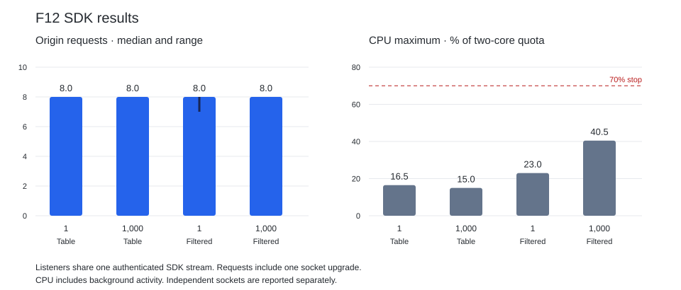

# F12: shared live tails and admission — 2026-11-04

The F10-shaped SDK matrix completed all 12 cohorts: both shapes, N=1 and N=1,000,
three repeats each. Origin requests stayed at 7–8 per cohort, including a single hint
socket upgrade, and every listener received the committed update. SQL read units and
the billed read component stayed zero. This is sharing among subscriptions on one
SDK client, not 1,000 physical client connections.

Three additional cohorts each delivered a hint to 1,000 independent sockets. Their
highest CPU sample was 51.5% of the actual two-core cgroup quota. Node-wide flight
counts included other shape traffic and cannot establish an isolated per-offset
computation count. A subsequent quiet rerun stopped at 73.0% during setup, before
readers started. **Quiet proof remains pending the parent's idle-CPU investigation
and its `baseline ok` handoff. F10 remains held.**

## SDK results

Origin counts include HTTP control/payload attempts and socket upgrades; hints and
CDN GETs are separate. Values list repeats 1/2/3. CPU is the largest one-second
process sample within each reader cohort, with no subtraction of background work.

| Shape | Listeners | Origin requests | Shared computations | CPU maximum, % of 2 CPUs | Delivered updates |
| --- | ---: | --- | --- | --- | --- |
| Table | 1 | 8 / 8 / 8 | 6 / 6 / 6 | 16.5 / 14.5 / 9.0 | 1 / 1 / 1 |
| Table | 1,000 | 8 / 8 / 8 | 6 / 6 / 6 | 10.0 / 15.0 / 11.5 | 1,000 / 1,000 / 1,000 |
| Where + columns | 1 | 8 / 8 / 7 | 6 / 6 / 4 | 5.5 / 23.0 / 16.0 | 1 / 1 / 1 |
| Where + columns | 1,000 | 8 / 8 / 8 | 6 / 6 / 6 | 7.0 / 10.5 / 40.5 | 1,000 / 1,000 / 1,000 |

Every cohort used one bootstrap, one epoch-key request, one socket, one hint and zero
HTTP long-polls. Every cohort used three manifest requests; eleven used two head requests, and
one baseline cohort used one. The six-computation total includes snapshot,
catch-up and head work; it is not six computations for one new offset.

Every cohort fetched its snapshot and initial sealed catch-up from the existing
ciphertext CDN. There were two cold CDN GETs in eleven cohorts and three in one baseline
cohort, all MISS in GRU. That baseline also read the final live update from the CDN.
Client sharing avoids fetching those objects separately for each listener. The final live
update may fall back to origin while its sealed object is being mirrored. These
results do not establish CDN HIT rates for independent clients or R2 GetObject counts.
The prior F10 report contains the independent-reader CDN HIT evidence.

## Independent sockets: first run

| Sockets | Shared computations, node-wide | CPU maximum, % of 2 CPUs | Hints delivered |
| ---: | --- | --- | --- |
| 1 | 15 / 17 / 14 | 27.0 / 42.0 / 23.0 | 1 / 1 / 1 |
| 1,000 | 32 / 32 / 23 | 44.5 / 44.0 / 51.5 | 1,000 / 1,000 / 1,000 |

Sockets were staged every 25 ms, below the Free request-rate allowance, using one
fresh bearer and a common authorized bootstrap handle and offset. After all sockets
were ready, they waited five seconds, then received one committed update's bound,
row-free hint. Staging takes longer than a 20-second shared wait, so a timeout can
start another shared wait for the same offset. Setup/bootstrap is excluded from this
table. This case proves socket delivery and safe capacity; it does not materialize
rows or perform CDN reads on each socket.

## Method, safety and source

The workload retains F10's 16 rows with a 128-byte body and one changed row. The
filtered shape selects `active = 1` and columns `id,version`. These small shapes do
not qualify large snapshots, long histories or native browser latency. Readers run
on admitted dev hosts through a temporary gru SSH CONNECT egress, using the public
API and customer credentials. The reported origin counts exclude setup, OAuth and
usage observations. Tail latency includes the write, mirroring and tunnel transit.

`free-reads-cpu.py` reads process ticks and divides by the minimum of affinity and
all cgroup v2 ancestor quotas. Every measured process had four affinity CPUs and a
two-core quota. It aborts on a sample above 70%, missing telemetry or process/capacity
changes. No guard override or four-CPU normalization is used.

- Feature source: `cd5666fda` through `4e0567d0165decc09954aa08ea734498052b39f4`.
- Measured driver and JS SDK: `8d0b036bb82845f722341d3eefa5ac6f399574ca`.
- First SDK serving revision: `4e0567d01`, process 3065658.
- Independent run and resumed SDK: `d0e1db758`, process 3070528. Its F12 source files
  are identical to `4e0567d01`; region write routing changed between the runs.
- [Initial deployment receipt](2026-11-04-f12-deployment.json) and
  [later deployment receipt](2026-11-04-f12-deployment-second.json) bind serving
  digests to green CI releases in gru, sjc and fra.
- [CDN rules](2026-11-04-f12-cdn-rules.json) preserve the F6 ciphertext-only boundary.
  Successful plaintext live replies are `private, max-age=1,
  stale-while-revalidate=1`, with `Vary: Authorization`; they are not public CDN data.

The [first SDK run](2026-11-04-f12-sdk-first.jsonl) contains ten complete cohorts and
a later 503. The [resumed run](2026-11-04-f12-sdk-resumed.jsonl) contains only the two
missing cohorts. No completed SDK cell was measured twice or replaced. The
[independent run](2026-11-04-f12-independent-first.jsonl) retains all six cells.

Earlier setup stops are retained separately: a fresh hosted project initially had
no TerraBase catalog entry ([startup](2026-11-04-f12-startup-stop.jsonl)), and the
initial metrics scrape used an outdated port ([metrics](2026-11-04-f12-metrics-stop.jsonl)).
Neither stop started readers. The [CPU stop](2026-11-04-f12-cpu-stop.jsonl) occurred
on a new process during setup, before readers; its database was deleted.
[Five subsequent telemetry-only samples](2026-11-04-f12-post-stop-telemetry.jsonl)
were 7.5–27.5%, insufficient to establish a stable idle baseline.

## Implementation and checks

Home and replica waits share a flight by granted shape handle and offset. Completed
live answers are retained one second. Lineage/control reads share a bounded,
commit-aware cache. HTTP waits and sockets share organization/node caps of
1,024/4,096; shared computations retain their 8/32 caps. Existing Free request-rate
and short-operation limits remain 50/s, burst 100 and four concurrent operations.
HTTP refusal is 429 with `Retry-After: 1`; an already upgraded socket gets a retry
frame and closes. Credentials and grants are rechecked before hints and after waits.

The happy-path integration test covers HTTP/socket sharing, equal answers and one
reader cancelling. The critical test checks a tenant's flight cap returns 429 and
Retry-After. TerraBase Fast passed 92 tests in 26.735 s; its slowest test was 9.152 s.
The JS suite passed 53 tests with one existing skip in 3.712 s. Benchmark Fast passed
in 9.460 s. Auth passed 52 tests in 35.050 s with existing timing overruns under the
#1084 temporary exception. JS type/declaration and route checks also passed.

Cleanup and the final quiet-proof receipt will be recorded after `baseline ok`.
