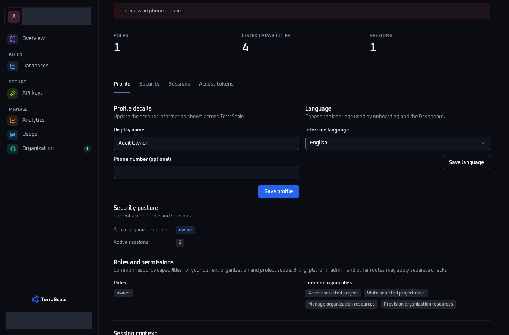
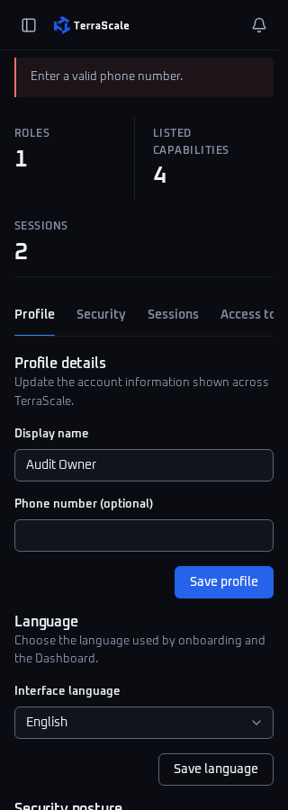
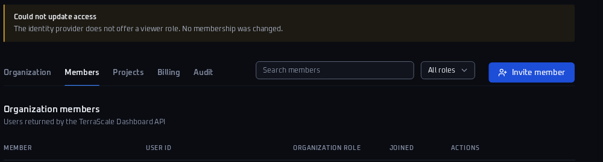
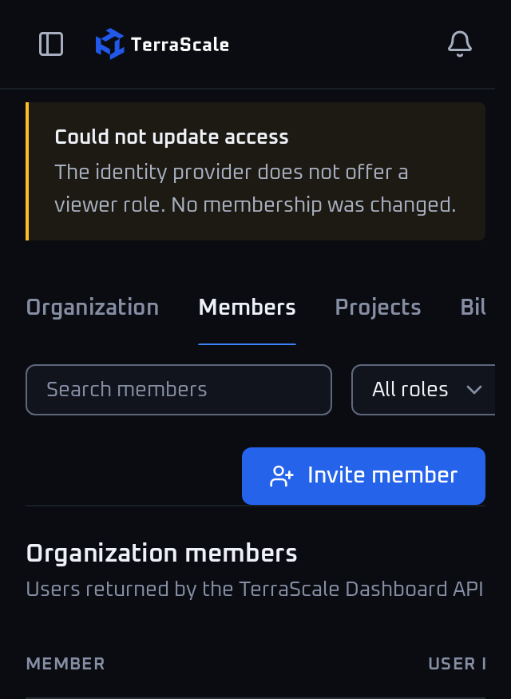

# Accounts, members and settings audit — 2026-10-13

## Publication against current main

This is a **historical audit** of source `b719878083dffd9441e063bbfaccfa0dffa95abd`. Publication was subsequently authorized with an explicit request to create and force-merge the PR. The branch was rebased without conflicts onto current main, most recently `95d16216a0750742261d19b0954a6ad9c9c44a12`; production source, shared fixtures and configuration remain unchanged by this audit.

Current main already addresses both historical findings: `3ac42a98a2b3449bdefc7c2dbbbd658f65e9eeda` offers every supported ts-auth role, including Viewer and Admin, and `5dc76dedcefd68085baa001524bef11c21d78a94` retains rejected profile drafts. **The two historical patch proposals below are superseded and must not be applied to current main.** Current Viewer support is valid under the canonical ts-auth contract; the old Viewer exclusion/rejection expectations now represent a contract difference, not a present product defect.

Only this audit's test setup was adapted for compilation: the invitation interface's project ID and `CreatedInvitation` result, the existing per-environment workspace registry and canonical invitation metadata, the current production access adapter over the fake ts-auth provider, canonical 26-character synthetic IDs, and independent fixtures for every case. The pagination case searches canonical fixture emails instead of names absent from the current provider's member DTO; row counting is scoped to the requested table's section. All original test assertions remain intact; none were disabled, skipped or relaxed. Fresh build, lint and focused HTTP/browser results against the publication head are recorded in ignored `evidence/publication-checks.json` and the PR description. The historical counts below must not be read as publication-head results.

Current main's `make lint` fails its isolation guard on the pre-existing billing audit's `NotInParallel` attribute at `tests/TerraScale.Dashboard.E2E/PagePaymentAudit/Oct13/billing-checkout-subscriptions/BillingCheckoutAuditJourneyTests.cs`. That file is outside this workstream and remains unchanged. This audit's own fixtures use independent per-case instances with no parallel limiter. The force-merge request does not make the inherited lint failure or historical Viewer assertion failures green; both are disclosed explicitly.

The six committed sanitized PNGs and their original hashes still belong to actual capture head `7ab7352cc0d47374a2f7346d623552e7a069392a`. They show the historical defects before the fixes, not current-main behavior. No capture is relabeled as having been made at a later rebased head. Invitation-history confidentiality remains a separately described policy question; current main also revised the related MCP role contract, so the old MCP observation below is historical.

## Historical findings

Two verified P2 defects: organization forms offer a Viewer role that the service always rejects, and profile validation errors discard unsaved form values. Existing application, shared fixtures, configuration, locks and generated tracked files are unchanged. The source patches below are proposals only.

Audited source/base: `b719878083dffd9441e063bbfaccfa0dffa95abd`. Branch: `audit/accounts-members-settings-20261013`. Original tested/capture head: `7ab7352cc0d47374a2f7346d623552e7a069392a`. Sanitized screenshot provenance is committed in [screenshot-provenance.json](screenshot-provenance.json); the final local head and subsequent focused checks are recorded in ignored `evidence/current-head-checks.json` and the final handoff. The later evidence-only commit is not claimed as the original capture head. Publication is withheld until the coordinator grants the serialized CI slot; no PR, push, merge or CI change has been performed.

## 1. P2 — Offered organization roles disagree with the service

**Routes:** `GET /organization?tab=members` (also `tab=invitations`); `POST /api/v1/access/invitations?tab=invitations`; `POST /api/v1/access/members/{id}/role?tab=members`.

**Source:** `src/TerraScale.Dashboard/Features/Organizations/OrganizationMembers.cshtml:16` offers Member/Viewer for invitations. `OrganizationMemberRow.cshtml:10` offers the same role choices and renders an existing Admin as a disabled empty option. `OrganizationOperations.AvailableRole` accepts Member/Admin and always rejects Viewer with 422; both `InvitationService.CreateAsync` and `OrganizationOperations.MutateMemberAsync` call it. `TsOrganizationAccess.Role` also maps only Member/Admin to provider roles.

**Reproduce with local synthetic data:**

1. Sign in as the audit owner and open `/organization?tab=members`.
2. Enter `never-sent@example.test`, select Viewer, and press Create invitation.
3. Observe HTTP 422: “The identity provider does not offer a viewer role. No membership was changed.” Repeating the POST still creates no invitation. Selecting Viewer for an editable member similarly cannot produce a successful role change.

**Expected:** Every offered mutation role is supported by the provider; an existing Admin has a valid selected option. Owner/self protections remain enforced. A legacy Viewer may still appear in read-only presentation or filters; that does not justify offering it for mutations.

**Minimal proposed patch:** [proposals/01-supported-member-roles.patch](proposals/01-supported-member-roles.patch). Replace Viewer with Admin in the invite form and member role selector; select Admin correctly for existing administrators. Two view files, three replacements. Do not add Viewer support or loosen the service authorization checks.

**Evidence:** Native HTTP rejection and collaborative-browser submission; strict expected-role assertions fail in HTTP and at 1366×900 / 320×900. Owner screenshots show the live role controls. These are current behavior captures, not fabricated post-fix images. Applying only this proposal is expected to resolve the role-option regressions; that prediction has not been tested against patched source.

## 2. P2 — Invalid profile POST loses both draft fields

**Routes:** `GET /profile`; `POST /api/v1/dashboard/profile`.

**Source:** `src/TerraScale.Dashboard/Features/Profile/ProfileChanges.cs:16` rejects a phone value exceeding 64 UTF-8 bytes before writing. `ProfileEndpoints.cs:81` reconstructs the error page solely from saved account context. `ProfileView.cshtml:12` reads the inputs directly from that saved account, so the valid name draft and invalid phone disappear.

**Reproduce with local synthetic data:**

1. Sign in as the audit owner and open `/profile`.
2. Set Display name to `Draft display name` and Phone number to 65 ASCII digits.
3. Press Save profile. Observe HTTP 422 with “Enter a valid phone number.” The input resets to `Audit Owner`; Phone number becomes empty. `/api/v1/auth/me` remains byte-for-byte unchanged.

**Expected:** The 422 page retains both submitted values so the user can correct the phone without retyping the name. The failed request must not mutate saved account state or identity.

**Minimal proposed patch:** [proposals/02-preserve-profile-drafts.patch](proposals/02-preserve-profile-drafts.patch). Add nullable draft name/phone to `ProfilePage`, populate them from the rejected native form, and render them ahead of saved values. The drafts belong only to the error-page model; do not mutate `AccountRecord` to redisplay them. Language errors keep the existing saved-profile presentation. Razor continues to escape the input values. Two source files; no persistence or provider changes.

**Evidence:** One native HTTP regression and two actual-browser regressions fail on retained-name assertions. Both browser cases first confirm HTTP 422 and pass WCAG checks on the error page. Draft/error pairs are captured at desktop and narrow widths. Phone preservation assertions remain intact after the name assertion; the first failure stops their execution, while direct browser observation confirms the phone is cleared.

## Authorization-policy question — invitation-history email visibility

This is **not classified as a verified security defect**. The ordinary synthetic member can read saved invitation email/role/status history through `/organization?tab=members` and `tab=invitations`, while the owner-only invite and mutation controls are absent and direct member mutations return 403.

The current contracts point in different directions: `TsOrganizationAccess.ReadAsync` fetches provider invitations only for `context.CanManage`; `OrganizationFilters.cs` merges canonical invitation records into `OrganizationPage.InvitationRows` regardless of that permission. `OrganizationMcpTools.ListInvitations` likewise returns canonical history after ordinary membership resolution, without an explicit owner/admin requirement. Existing organization journeys cover owner operations and denial of mutations, but the inspected tests do not establish a confidentiality policy for historical invitee emails.

`CandidatePolicyOrdinaryMembersCannotReadInvitationHistory(members/invitations)` keeps strict management-only expected assertions under category `AuthorizationPolicyQuestion`. Both currently fail. They document a **candidate policy**, not proof that the established product policy has been violated. No visibility restriction patch is proposed until intended policy is confirmed; do not silently make these assertions accept the observed behavior.

## Historical verification

| Focused check | Result |
| --- | --- |
| Locked Release build of application + existing E2E project | PASS, 0 warnings / 0 errors |
| HTTP audit: 8 cases | 4 PASS; 2 confirmed-defect FAIL; 2 candidate-policy FAIL |
| Browser audit: 6 cases, 1366×900 / 320×900, original tested head `7ab7352c` | 2 PASS; 4 confirmed-defect FAIL |
| New C# whitespace verification | PASS |
| `scripts/verify-e2e.py`, `scripts/verify-sdk.py`, `make check-css` | PASS |
| Both proposed patches, `git apply --check` | PASS; proposals not applied |
| Full `make lint`, aggregate `test-fast` / `test-slow`, production/live qualification | NOT RUN |

The final report head is checked again with the locked build, all eight HTTP cases, all six browser cases and the focused lint/patch checks. The latest user clarification permits the already-authorized synthetic local browser sign-in; real/external account sign-in remains prohibited. The fixture registers only invented `@example.test` principals and replaces authentication, organization access and HTTP transport with the existing test contracts. The existing shared host uses an ephemeral port; browser navigation stays on its `http://127.0.0.1` origin. Test sources and all failing assertions are unchanged. Detailed final-head results, new raw capture hashes and exact commands live separately in ignored `evidence/current-head-checks.json` after verification. All committed PNGs remain pinned to the original tested/capture head; original assets are preserved under ignored `evidence/original-capture-7ab7352c/` before rerunning screenshot-producing cases.

Passing journeys cover 10-row member/invitation pagination with page clamping and useful empty filters; owner/member role-aware controls and denied mutation; repeated rejected Viewer invites without state change; invalid/denied retention settings without provider writes; safe 503 settings responses; unavailable organization provider and recovery. Browser journeys verify keyboard activation and focus restoration for Escape/Cancel/Close, no member removal on cancellation, keyboard horizontal table scrolling, no page overflow at 320 px, accessible dialog/empty/profile-error states, Clear filters, and Back/Forward between cleared members and profile. Existing `BrowserAudit` runs WCAG 2.2 A/AA tags. The inherited Playwright environment skips host prerequisite validation; Chromium launched and every case reached its application assertions.

The collaborative browser additionally verified native Viewer POST rejection and profile value loss. A submitted Datastar member search currently changes the table without updating the URL, and reload loses the filter. This is a separate UX follow-up outside the two prioritized patch proposals. Back/Forward evidence above covers ordinary navigation after clearing filters, not restoration of that unsaved search.

### Exact local commands

Run sequentially from this bound worktree. All outputs below remain under the unique report directory. `IsolatedAuditBuild.targets` overrides only the asset-generation target for this read-only source audit; it does not replace or disable application/test assertions. The fixture serves exact committed Datastar and button-loading sources, with committed CSS and brand assets.

```bash
nice -n 19 dotnet build tests/TerraScale.Dashboard.E2E/TerraScale.Dashboard.E2E.csproj \
  --configuration Release -p:RestoreLockedMode=true \
  -p:ArtifactsPath="$PWD/docs/reviews/2026-10-13/accounts-members-settings/obj/build" \
  -p:CustomAfterMicrosoftCommonTargets="$PWD/docs/reviews/2026-10-13/accounts-members-settings/IsolatedAuditBuild.targets"

nice -n 19 dotnet docs/reviews/2026-10-13/accounts-members-settings/obj/build/bin/TerraScale.Dashboard.E2E/release/TerraScale.Dashboard.E2E.dll \
  --treenode-filter '/*/*/AccountsMembersSettingsAuditJourneyTests/*' --report-trx \
  --results-directory "$PWD/docs/reviews/2026-10-13/accounts-members-settings/evidence" --report-trx-filename accounts-http-final.trx

nice -n 19 dotnet docs/reviews/2026-10-13/accounts-members-settings/obj/build/bin/TerraScale.Dashboard.E2E/release/TerraScale.Dashboard.E2E.dll \
  --treenode-filter '/*/*/AccountsMembersSettingsBrowserAuditJourneyTests/*' --report-trx \
  --results-directory "$PWD/docs/reviews/2026-10-13/accounts-members-settings/evidence" --report-trx-filename accounts-browser.trx

nice -n 19 dotnet format whitespace tests/TerraScale.Dashboard.E2E/PagePaymentAudit/Oct13/accounts-members-settings --folder --verify-no-changes
nice -n 19 python3 scripts/verify-e2e.py
nice -n 19 python3 scripts/verify-sdk.py
nice -n 19 make check-css
```

The two audit runs intentionally exit 2 because their expected-behavior regressions are red. Do not mark them green, skip their assertions, or treat the suite as release-ready. Tests use synthetic reserved-domain identities, deterministic membership/history records and existing test-only provider contracts; no real invitations, account/security changes, customer data, paid resources or payments occur.

## Files and evidence

New test directory: `tests/TerraScale.Dashboard.E2E/PagePaymentAudit/Oct13/accounts-members-settings/`.

1. `AccountsAuditScenario.cs` — isolated synthetic host/provider setup.
2. `AccountsMembersSettingsAuditJourneyTests.cs` — eight HTTP cases, including two explicitly pending policy cases.
3. `AccountsMembersSettingsBrowserAuditJourneyTests.cs` — six desktop/narrow browser cases and captures.
4. `AccountsAuditPreviewJourneyTests.cs` — explicit 15-minute synthetic host for the collaborative browser; finish via local `/__audit/finish`.

Report files: this `README.md`, `IsolatedAuditBuild.targets`, `.gitignore`, the two patch files under `proposals/`, [screenshot-provenance.json](screenshot-provenance.json), and six sanitized PNGs under `screenshots/`. The user explicitly authorized these small synthetic PNGs to be committed in this unique report directory. Ignored `evidence/` retains original captures, TRX, current-head validation and the original SHA/hash manifest. No video is committed.

### Reviewable desktop and mobile captures

All six images were captured from the actual local synthetic app at `7ab7352cc0d47374a2f7346d623552e7a069392a`, then sanitized locally. These show the existing defects; no proposed patch was applied. Desktop profile captures mask synthetic sidebar identity/scope and any visible session ID. Viewer captures crop out identity rows and the desktop account sidebar. Mobile profile captures have no visible email or ID. The invented saved name `Audit Owner`, draft name and invalid 65-digit phone remain visible because their disappearance is the profile defect evidence. Retained pixels were verified against the originals; no rescaling or image generation occurred. The provenance JSON records original/output SHA-256 hashes, original/output dimensions, masks/crops and byte sizes.

| Flow and actual capture head | Desktop | Mobile |
| --- | --- | --- |
| `/profile` draft before POST — `7ab7352c` | [Draft, 1366×900](screenshots/profile-draft-desktop.png) | [Draft, 320×900](screenshots/profile-draft-mobile.png) |
| `/api/v1/dashboard/profile` HTTP 422 loses draft — `7ab7352c` | [Name reset and phone cleared, 1366×900](screenshots/profile-error-desktop.png) | [Name reset and phone cleared, 320×900](screenshots/profile-error-mobile.png) |
| Native Viewer invitation POST rejected — `7ab7352c` | [Provider rejection, desktop crop](screenshots/viewer-rejection-desktop.png) | [Provider rejection, 320px CSS viewport crop](screenshots/viewer-rejection-mobile.png) |









The original collaborative-browser recording, `evidence/original-capture-7ab7352c/native-forms-desktop-mobile-7ab7352c.mp4`, is **local-only** (1,371,555 bytes). Its original hash and capture SHA are preserved in the committed provenance JSON. It contains invented fixture identities and has not been sanitized for publication; it is neither a Git deliverable nor a published attachment.

## Overlap and release limits

Shared R3–R6 refactoring may move the proposed view/model locations; the owner should rebase these minimal proposals onto the final layout. No owner thread was contacted or read. Banner-removal and guided-import work are untouched. Organization MCP role descriptions/whitelists still refer to Viewer and reject Admin; that related contract mismatch is recorded for its owning implementation work, beyond the two page patches.

There is no GET `/settings` page in this checkout. This audit exercises `/api/v1/dashboard/settings/audit-retention` for page-level validation/denial/provider-error behavior. Backup/restore and deletion implementations were not expanded into this workstream. Production identity delivery, durable restart/replication, real ts-auth, live customer-SDK qualification and billing release gates remain outside this local fixture audit. Aggregate suites were avoided to preserve release-critical job priority. No publication or CI run is authorized yet.
