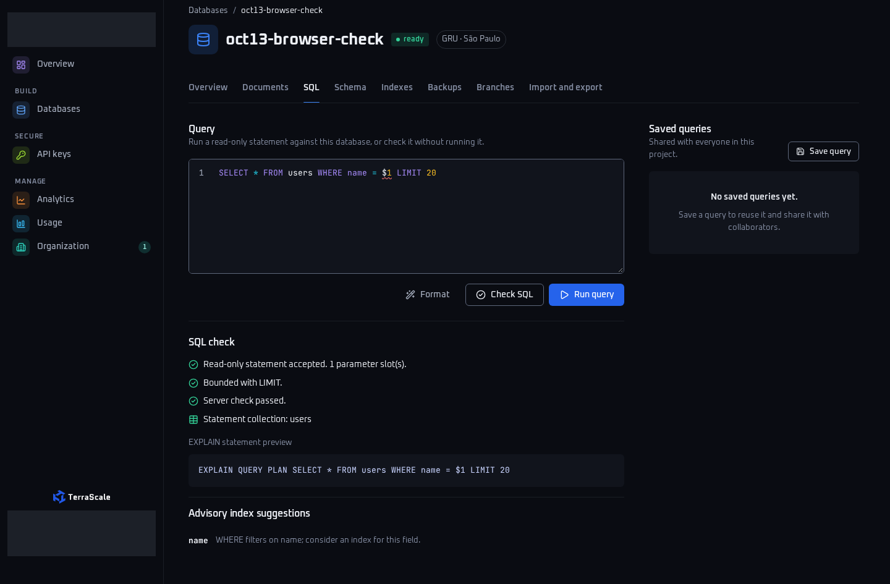
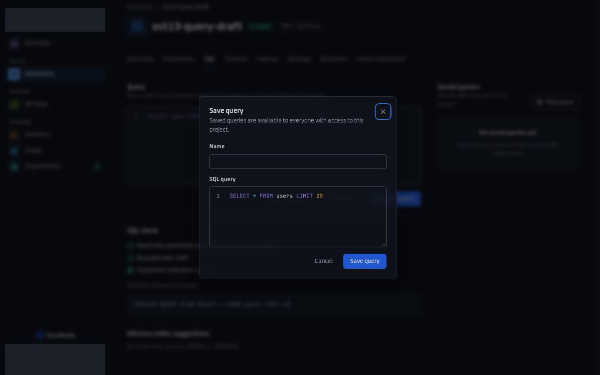

# Database and data-access page audit

Three verified P2 defects need source fixes: SQL check announces success for an unbound `$1`, Save query persists the previous server-rendered SQL instead of the editor draft, and the database list reports zero documents when counts are unavailable. The new regressions deliberately remain failing. No source fix has been applied.

| Bug key | Exact boundary | Observed / expected | Proposal |
| --- | --- | --- | --- |
| DDA-01 | `POST /api/v1/dashboard/data/sql/check`, HTML response | “Server check passed.” despite an error diagnostic / display the diagnostic and withhold success | [01-sql-check-diagnostics.patch](01-sql-check-diagnostics.patch) |
| DDA-02 | `/databases/{databaseId}/sql` → `POST /api/v1/dashboard/data/saved-queries` | Saved SQL is the initial query / save the current editor draft | [02-save-current-query-draft.patch](02-save-current-query-draft.patch) |
| DDA-03 | `GET /databases` during producer count outage | Documents total is `0` / display unknown until measurements recover | [03-unknown-database-list-counts.patch](03-unknown-database-list-counts.patch) |

These are reproducible behavior defects, independent of any role-policy question. P2 means ordinary workflows produce misleading validation or lose the user's intended query/count information; no production incident or document-data loss is claimed.

## Revision and publication state

- Audited source SHA, checkout base, and source-only HEAD: `b719878083dffd9441e063bbfaccfa0dffa95abd`.
- Local delivery branch: `audit/database-data-access-20261013`, bound to `/home/mariogk/.t3/worktrees/ts-dashboard/audit-database-data-access-20261013`.
- `origin/main` resolved to the audited SHA during verification. No rebase or source changes were performed.
- Actual browser capture/test SHA: `6d05a7ee374547ee8ceab938ee14eabc86d9a22f`. [Committed evidence provenance](evidence/manifest.json) preserves that SHA, original capture times, raw SHA-256 hashes, mask rectangles and sanitized hashes. These images were not recaptured at the later evidence-delivery head.
- The final evidence-delivery SHA is reported in the handoff and ignored `obj/evidence-followup-verification.json`; it cannot be embedded in its own commit. Source and test files remain identical to the capture SHA.
- No push or PR publication: Mongo holds the active serialized slot, and the coordinator must grant this audit's explicit slot later. Alpha CI is permitted once that slot is granted. Any eventual PR must remain draft while defect regressions fail; do not merge or enable auto-merge.

The actual checkout uses .NET 10, C#, RazorSlices and Datastar, with TUnit journeys in `tests/TerraScale.Dashboard.E2E`; it is not the old Go layout. Verification follows [development instructions](../../../development.md) and uses SDK `10.0.401` plus the existing pinned Playwright/Chromium workflow.

## DDA-01 — SQL check falsely accepts an unbound `$1` (P2)

**Reproduce on a locally provisioned test database:**

1. Open `/databases/{databaseId}/sql` and enter `SELECT * FROM users WHERE name = $1 LIMIT 20` in Monaco.
2. Focus **Check SQL** and press Enter.
3. Observe the native HTML navigation response from `POST /api/v1/dashboard/data/sql/check`: HTTP 200, “Read-only statement accepted. 1 parameter slot(s).” and “Server check passed.” No query-result table appears.
4. Submit the same form fields (`databaseId`, `sql`, valid local `_csrf`) to the check endpoint with JSON negotiation: HTTP 200 with a `severity: "error"` diagnostic saying “The console cannot bind parameters such as $1; replace them with values.”
5. Submit the same statement to `POST /api/v1/dashboard/data/sql`: HTTP 422.

**Expected:** the HTML check must agree with its JSON diagnostics and execution gate. Preserve the statement, show the binding error, and omit the success claim. The proposal preserves the existing check endpoint's HTTP 200 diagnostic contract.

**Cause:** [DataEndpoints.cs:95–99](https://github.com/TerraScale/ts-dashboard/blob/b719878083dffd9441e063bbfaccfa0dffa95abd/src/TerraScale.Dashboard/Features/Data/DataEndpoints.cs#L95) computes diagnostics but unconditionally supplies `sqlChecked: true` to the HTML page. [SqlValidation.cs](https://github.com/TerraScale/ts-dashboard/blob/b719878083dffd9441e063bbfaccfa0dffa95abd/src/TerraScale.Dashboard/Features/Data/SqlValidation.cs#L21) treats parameters as diagnostic errors, while `Analyze` accepts numbered `$1` as a slot. [SqlAnalysisCard.cshtml:11](https://github.com/TerraScale/ts-dashboard/blob/b719878083dffd9441e063bbfaccfa0dffa95abd/src/TerraScale.Dashboard/Features/Data/SqlAnalysisCard.cshtml#L11) consequently renders the server-success text. The execution/saved-query branch at `DataEndpoints.cs:101` correctly rejects diagnostic errors.

**Minimal proposal:** pass the first error diagnostic to `formError`; set `sqlChecked` only when diagnostics contain no error. Warnings retain the existing behavior. The patch touches only `Features/Data/DataEndpoints.cs` when applied by the source owner.

**Evidence:** one failing HTTP case and two failing browser cases (1440×900 and 390×844). The otherwise identical `?` statement is a passing control: HTML already rejects it. Browser tests enter text through Monaco's focused keyboard surface, verify the submitted textarea, and inspect the actual HTML response. See `sql-check-{1440,390}.png` in the evidence table below.

## DDA-02 — Save query persists stale SQL (P2)

**Reproduce:**

1. Open `/databases/{databaseId}/sql`; its initial query is `SELECT * FROM users LIMIT 20`.
2. Replace the console text with `SELECT name FROM users WHERE name = 'audit-local' LIMIT 5` using the editor keyboard. Do not run or check the query first.
3. Focus **Save query** and press Enter. The dialog's SQL field still contains `SELECT * FROM users LIMIT 20`.
4. Cancel, reopen, Close, and reopen. The console draft is retained, but the dialog remains stale. Name the query `audit-current-draft` and submit **Save query**.
5. Read `GET /api/v1/dashboard/data/saved-queries`: the stored query has the initial SQL. Navigate to `/databases/{databaseId}/documents`, use Back and Forward, and verify the saved-query and documents URLs remain navigable.

**Expected:** each opening of Save query starts with the current console SQL. Cancel/Close leave the console draft intact, and the save POST and subsequent API read contain the intended draft.

**Cause:** [DataView.cshtml:35–39](https://github.com/TerraScale/ts-dashboard/blob/b719878083dffd9441e063bbfaccfa0dffa95abd/src/TerraScale.Dashboard/Features/Data/DataView.cshtml#L35) renders independent `#sql` and `#saved-sql` fields from `Model.Sql`; the native modal command does not copy edits between them. [code-editor/index.js:92–105](https://github.com/TerraScale/ts-dashboard/blob/b719878083dffd9441e063bbfaccfa0dffa95abd/src/TerraScale.Dashboard/web/assets/js/code-editor/index.js#L92) synchronizes Monaco and its own textarea, not the two separate editors. The save endpoint persists the submitted dialog field.

**Minimal proposal:** the Save query opener's Datastar click handler copies `#sql.value` to `#saved-sql.value` and dispatches the existing `input` event, allowing the dialog's Monaco model to synchronize. Native keyboard activation also fires this handler. This proposal uses the already shipped Datastar/editor contract; a JavaScript-disabled flow has not been validated.

**Evidence:** two failing browser cases, desktop and mobile. Each completes Cancel, Close, save submission, API read and Back/Forward before the final defect assertion. The independent API observation is recorded in `saved-query-values-{1440,390}.json`:

```json
{
  "ConsoleDraft": "SELECT name FROM users WHERE name = 'audit-local' LIMIT 5",
  "DialogSql": "SELECT * FROM users LIMIT 20",
  "PersistedSql": "SELECT * FROM users LIMIT 20"
}
```

This is saved-query metadata loss; the test does not execute a write statement or alter application documents.

## DDA-03 — Count outage becomes measured zero on the database list (P2)

**Reproduce:**

1. Provision an empty database using only the local protocol fixture; `GET /databases` correctly reports zero documents.
2. Make the local producer return HTTP 503 for management `GET /v1/management/.../collections` requests.
3. Reload `/databases`: HTTP 200 preserves the database detail link and shows “Database counts are unavailable. The data plane did not answer.”, but Documents remains `0` with an empty collection aggregate.
4. Restore the local producer and reload. The error disappears and the real empty-database total is zero again.

**Expected:** an unavailable total is unknown (`—`, “Not reported by provider”), not zero or a partial sum. The database navigation must remain usable; a later successful read may show a true zero.

**Cause:** [DatabaseEndpoints.cs:107–121](https://github.com/TerraScale/ts-dashboard/blob/b719878083dffd9441e063bbfaccfa0dffa95abd/src/TerraScale.Dashboard/Features/Databases/DatabaseEndpoints.cs#L107) catches the count request failure without recording aggregate availability. [DatabasesView.cshtml:14](https://github.com/TerraScale/ts-dashboard/blob/b719878083dffd9441e063bbfaccfa0dffa95abd/src/TerraScale.Dashboard/Features/Databases/DatabasesView.cshtml#L14) sums the remaining list. The detail page already follows the expected unknown-state convention through `ContentsAvailable`.

**Minimal proposal:** carry aggregate count availability in `DatabasesPage`; mark it unavailable if any database count request fails; withhold the aggregate and collection/byte detail until all reads succeed. The new boolean is response measurement state, not a feature switch or configuration. This proposal touches `Features/Databases/{DatabaseEndpoints.cs,DatabasePages.cs,DatabasesView.cshtml}` only when applied by the owner. Malformed-provider and overflow handling are outside this verified HTTP-503 repro.

**Evidence:** one failing HTTP journey that first verifies the healthy zero, checks outage navigation/error text, restores the producer and verifies recovery before asserting the outage total must be `—`. No browser screenshot was captured for this finding.

## Scoped routes and passing coverage

| Surface | Routes inspected/tested | Verified behavior |
| --- | --- | --- |
| Database list/detail and Data | `/databases`, `/databases/{databaseId}/sql`, `/databases/{databaseId}/documents`; `/api/v1/dashboard/data/sql`, `/sql/check`, `/saved-queries` under the same data API prefix | Count outage/recovery; the two editor defects; browser history; interrupted SQL request cancels the producer and a later read succeeds |
| API Keys | `/api-keys?kind=key`; credential writes are under `/api/v1/dashboard/credentials` | Empty filter state; keyboard dialog opening; Cancel, Close and Escape; repeated openings; no credential POST or actual API-key creation |
| Backups | `/databases/{databaseId}/backups`, `/api/v1/dashboard/backups` | Empty restore-point state; existing eight-case backup-policy outage/deadline/invalid-data coverage remains green with known snapshots retained |
| QuerySubscriptions | `/subscriptions`; `/api/v1/dashboard/subscriptions/{attach,pause,resume,detach}` | Empty configuration state; existing endpoint/role contract journey passes. Producer mutation support remains explicitly unavailable in source; no product change proposed |
| Authentication providers | `/auth/connections`, `/authentication/connections`; source maps `/api/v1/auth-management/{**path}` | Both aliases show honest HTTP 503/unavailable content; no provider-management mutation attempted. Project-scoped credential/API binding is explicitly unavailable in current source |

At both browser sizes, the five management URLs above pass the checkout's WCAG 2.2 AA-tagged Axe assertions and have no document-level horizontal overflow. The credential dialog passes those assertions after its entrance animation settles. These automated checks do not establish complete assistive-technology usability. SQL/editor regressions verify keyboard activation and visual behavior; they do not claim a separate full Axe audit of Monaco.

The interruption check uses real dashboard HTTP cancellation and observes `RequestAborted` at the local SQL producer, then succeeds on retry. It does not establish a dedicated visible Cancel-query control or duplicate-submission prevention. Repeated modal openings are covered; concurrent save double-clicks are not.

## Test files and reproducible commands

Only these new test files are included:

1. [DatabaseDataAccessJourneyTests.cs](../../../../tests/TerraScale.Dashboard.E2E/PagePaymentAudit/Oct13/database-data-access/DatabaseDataAccessJourneyTests.cs): HTTP diagnostic/execution consistency (`$1` and `?`), count outage/recovery, query interruption/retry.
2. [DatabaseQueryDraftBrowserJourneyTests.cs](../../../../tests/TerraScale.Dashboard.E2E/PagePaymentAudit/Oct13/database-data-access/DatabaseQueryDraftBrowserJourneyTests.cs): SQL-check and save-draft regressions plus empty/unavailable management pages at desktop/mobile sizes.

Run the focused audit from the checkout root:

```sh
nice -n 19 dotnet run --configuration Release \
  --project tests/TerraScale.Dashboard.E2E -- \
  --treenode-filter '/*/TerraScale.Dashboard.E2E.PagePaymentAudit.Oct13.DatabaseDataAccess/*/*' \
  --report-trx \
  --results-directory "$PWD/docs/reviews/2026-10-13/database-data-access/obj/head-results"
```

| Check | Result | Evidence / limits |
| --- | --- | --- |
| Focused new journeys at capture SHA `6d05a7ee` | **FAIL as expected: 10 total, 6 failed, 4 passed, 0 skipped** | `$1` HTTP, list outage and four desktop/mobile defect cases fail; `?`, cancellation/retry and two management cases pass. Assertions are neither disabled nor marked expected-failure in the runner |
| `nice -n 19 make build` | **PASS**, zero warnings/errors | Locked Release solution build; focused run also compiles the final test changes |
| `nice -n 19 make lint` | **PASS** | CSS consistency, SDK provenance, E2E boundary guard and `dotnet format --verify-no-changes --no-restore` |
| Existing backup/subscription journeys | **PASS**, 8 + 1 cases | Filters `/*/*/BackupPolicyJourneyTests/*` and `/*/*/QuerySubscriptionJourneyTests/*`; logs in ignored `obj/backup-tests.log` and `obj/subscription-tests.log` |
| Proposed patches / source integrity | **PASS** for applicability and read-only checks | `git apply --check` for all three proposals together; existing tracked files unchanged. This is not runtime validation of the proposed fixes |

The last pre-commit keyboard-input run completed in 47.723 seconds. Raw failure logs/TRX are under ignored `obj/keyboard-tests.log` and `obj/keyboard-results/`. The run at capture SHA `6d05a7ee374547ee8ceab938ee14eabc86d9a22f` completed in 26.950 seconds; its logs/TRX remain in `obj/head-tests.log` and `obj/head-results/`.

The initial evidence-only follow-up at `00cf8dce8a1e20fe664235e18a345a98119fe844` ran four HTTP cases: **2 passed, 2 expected defect failures, 0 skipped**, with every assertion intact. The `$1` HTML-success and outage-total regressions remained red; the `?` and cancellation/retry controls passed.

The coordinator subsequently clarified that the sign-in restriction applies to real/external accounts and permits the already-authorized synthetic local browser login. Final verification therefore runs **all ten focused HTTP/browser cases after the final documentation commit**, with results, exact tested HEAD and local capture hashes recorded separately in ignored `obj/evidence-followup-verification.json`. The older committed PNGs retain capture SHA `6d05a7ee374547ee8ceab938ee14eabc86d9a22f`; they are not relabeled as final-head captures.

The local-only boundary was rechecked before this run: `NativeWorkspaceAsync` in `DatabaseSdkJourneyTests.cs:222` generates synthetic `@example.test` accounts; `Demo/DemoHost.cs:31` owns a test-only `TestAuth` and replaces authentication gateways; `Demo/DatabaseSdkScenario.cs:56` creates the local producer/application hosts and redirects database SDK requests to the local producer, rejecting unknown outbound origins. Every browser navigation uses `scenario.Origin`, a loopback URL. `web/assets/js/code-editor/monaco.js` bundles Monaco without runtime CDN fetches; application CSP restricts scripts, fonts and connection requests to self. No real/external account login, credential retrieval, permission change or denied browser action is required.

Run the allowed focused follow-up from the checkout root:

```sh
nice -n 19 dotnet run --configuration Release \
  --project tests/TerraScale.Dashboard.E2E -- \
  --treenode-filter '/*/TerraScale.Dashboard.E2E.PagePaymentAudit.Oct13.DatabaseDataAccess/DatabaseDataAccessJourneyTests/*' \
  --report-trx \
  --results-directory "$PWD/docs/reviews/2026-10-13/database-data-access/obj/evidence-head-http-results"
```

The initial HTTP-only follow-up logs/TRX remain local-only in `obj/evidence-head-http-tests.log` and `obj/evidence-head-http-results/`. Final full verification uses:

```sh
nice -n 19 dotnet run --configuration Release \
  --project tests/TerraScale.Dashboard.E2E -- \
  --treenode-filter '/*/TerraScale.Dashboard.E2E.PagePaymentAudit.Oct13.DatabaseDataAccess/*/*' \
  --report-trx \
  --results-directory "$PWD/docs/reviews/2026-10-13/database-data-access/obj/evidence-final-full-results"
```

Final full-run logs/TRX are local-only in `obj/evidence-final-full-tests.log` and `obj/evidence-final-full-results/`. Fresh final-head raw captures and their own manifest are kept separately in `obj/capture-final-head/evidence/`. Original raw images are preserved in `obj/capture-6d05a7ee/evidence/` and restored to their original local paths after the run, so the committed provenance hashes continue to resolve. Exact final HEAD, full counts, lint outcome and source-integrity checks are recorded after commit in `obj/evidence-followup-verification.json`. No assertion or test file is modified for this verification.

**Not run:** full `test-fast`/`test-slow` aggregate suites, Alpha CI, live-production readiness, live ts-typescript account flow, production authentication/provider delivery, real database mutations and real payments. No new spend was authorized or incurred for services. These results qualify local test-host behavior only.

The journeys run actual application routes/assets against disposable local Kestrel hosts and an external local producer protocol fixture through the existing production database adapter/official SDK. Authentication and persistence providers are test-only. Only synthetic accounts, databases and saved-query metadata are created. No production origin, account, credential, import or payment system is contacted.

## Desktop/mobile evidence

Captures come from actual Chromium rendering of this bound worktree's application with bundled Monaco at SHA **`6d05a7ee374547ee8ceab938ee14eabc86d9a22f`**, captured on 2026-10-13 between 02:28:52 and 02:29:12 UTC. No patch was applied. The later delivery commit adds documentation/evidence only; it is not the capture SHA.

Eight small sanitized PNGs are committed under `docs/reviews/2026-10-13/database-data-access/evidence/`, totaling **556,805 bytes (0.53 MiB)**. This is the explicit user-authorized exception to the checkout's usual no-screenshots-in-Git rule, within the same repository and unique report directory. No new host, permission change or browser sign-in was used for this follow-up.

All eight images were inspected for personal data and secrets. Desktop workspace/account labels, fixture names/emails and avatars are replaced by opaque rectangles, including areas already blurred by the dialog. Every decoded pixel outside those rectangles is preserved; mobile images contain no identity areas and are exact original copies. The remaining database names and `audit-local` SQL value are synthetic repro labels. No API key, token, password or payment value appears. The [manifest](evidence/manifest.json) records original and sanitized hashes, original capture SHA/times, exact mask rectangles and pixel-preservation checks. Raw originals, logs and TRX remain ignored and local-only.

| Flow / description, all captured at `6d05a7ee` | Desktop viewport (1440×900) | Mobile viewport (390×844) |
| --- | --- | --- |
| Console contains the new query draft | [query-draft-1440.png](evidence/query-draft-1440.png) | [query-draft-390.png](evidence/query-draft-390.png) |
| Save dialog displays old SQL | [save-query-1440.png](evidence/save-query-1440.png) | [save-query-390.png](evidence/save-query-390.png) |
| SQL check shows success for `$1` | [sql-check-1440.png](evidence/sql-check-1440.png) | [sql-check-390.png](evidence/sql-check-390.png) |
| Credential dialog inspected without issuing a key | [api-key-dialog-1440.png](evidence/api-key-dialog-1440.png) | [api-key-dialog-390.png](evidence/api-key-dialog-390.png) |
| Independent saved-query API observation | [saved-query-values-1440.json](evidence/saved-query-values-1440.json) | [saved-query-values-390.json](evidence/saved-query-values-390.json) |

These are full-page captures, so image heights can exceed their viewport heights. The relative links resolve in this committed report and will use the same repository when publication is authorized. No upload or publication has occurred. No video was captured or committed. These screenshots document verified defects on the original capture SHA, not green release qualification at a later head.





## Source-owner dependencies and delivery boundary

The three proposals overlap the active shared R3–R6 refactoring in the Data/Databases source areas. The source owner must adapt/apply them against its current head and rerun these regressions; applicability is pinned to the audited SHA. No source-owner thread or cancelled history was read or contacted. The banner work needs no change here. Guided imports and import-owned files are excluded entirely.

The committed deliverable consists of this report, three linked `.patch` proposals, two linked test files and eleven evidence files (eight PNGs, two small saved-query observation JSON files and one provenance manifest): **17 new files in total relative to the audited base**. This follow-up adds eleven files and updates only this workstream's report. Existing source, shared/refactor code, fixtures, projects, settings, CI, locks, vendor files, AGENTS and tracked generated assets remain unchanged. Ignored build/dependency/raw-evidence outputs are local verification artifacts only.

Next publication action: wait for the coordinator's explicit serialized slot after Mongo and release-critical jobs permit it. Before publication, fetch and assess the latest `origin/main`, revalidate changed source assumptions, rerun permitted focused checks if the head changes, and preserve the original capture SHA. Recapture changed product behavior only within the authorization then in effect. Keep the draft unmerged while the product regressions remain red.
