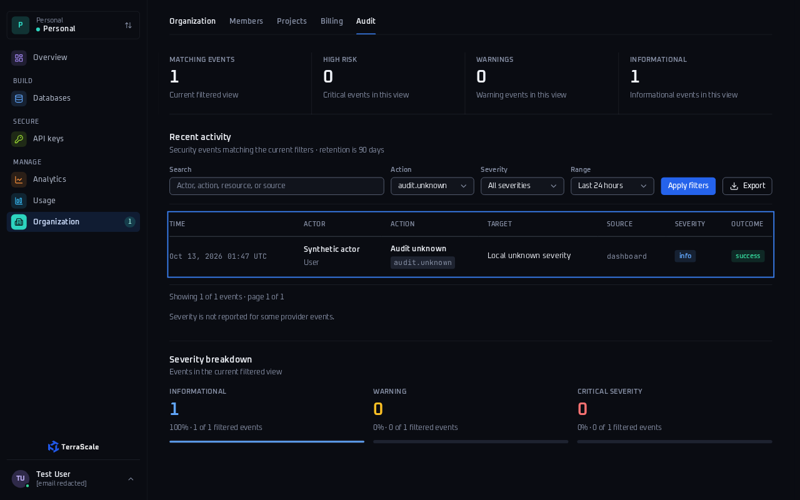
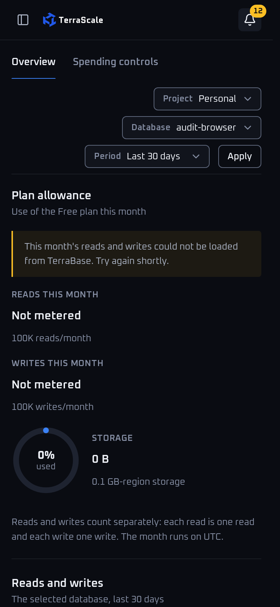
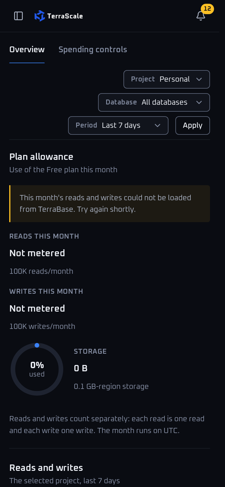

# Usage, Analytics, Home, Audit and Notifications audit

## Publication refresh after current main integration

The user authorized PR publication and requested auto-merge. This branch was rebased cleanly onto **95d16216a0750742261d19b0954a6ad9c9c44a12** (current origin/main). The PR still introduces only the 36 authorized new test/report/evidence files; no production, shared fixture, project, CI or configuration changes.

Both historical P2 findings are fixed upstream: **eb849adc** makes missing/unrecognized audit severity unknown, and **e1e98711** preserves Usage period/database navigation. Both strict regressions now pass. Current focused results are **9 passed / 5 retained contract-policy failures, 14 total**: HTTP 6 passed / 5 failed; browser 3 passed / 0 failed. The remaining five cases concern duplicate-row grain, omitted-minute gaps and current-versus-historical region placement. They remain questions, with unchanged strict assertions; they are not newly labeled producer bugs.

Current main's AnalyticsBackendContractTests.SixDenseDatabaseRegionSeriesRemainMeasuredBeyondTheSmallPlatformEnvelope explicitly accepts gru/sjc series for database records whose home Region is GRU. Therefore the two current-placement rejection assertions propose a policy change from existing dashboard coverage; they do not establish an authorization defect or an upstream producer violation. Cross-item duplicate uniqueness and wholly omitted bucket meaning remain unspecified by the current analytics presentation/interface documentation.

Current lint requires independent fixtures. The three new journey classes now use per-test ClassDataSource instances, without session sharing or parallel limiters. Each running scenario already owns its provider state; synthetic Analytics evidence is additionally separated by database ID to avoid parallel file collisions. No assertion was disabled, deleted, skipped or weakened. Build and full make lint passed on the preceding source base 7d0420ef. The final main base 95d16216 adds an unrelated billing audit whose NotInParallel attribute fails scripts/verify-e2e.py:40 at tests/TerraScale.Dashboard.E2E/PagePaymentAudit/Oct13/billing-checkout-subscriptions/BillingCheckoutAuditJourneyTests.cs. That baseline file is outside this audit's writable scope; it remains untouched. Scoped formatting, CSS, SDK provenance, Slow-report self-check and document-change checks pass. Aggregate Fast/Slow remain unrun; five included Fast assertions are known red. GitHub reports allow_auto_merge=false. The audit is prepared for draft publication; no repository setting or merge gate is changed to make it mergeable.

The presentation patch is a **historical artifact against b719** and no longer applies to current main because the fixes landed upstream. The two conditional Analytics/placement patches still pass git apply --check on the rebased source; neither was applied or compiled. All committed PNGs and compact fixtures below retain their original b719 capture provenance and hashes. Current browser verification is separate and local-only. Exact PR head and remote-head verification are supplied in the PR/handoff.

## Historical audit at the pinned source

Two concrete presentation defects were verified at b719: missing audit severity was classified as informational, and Usage tab navigation discarded the selected period/database. Duplicate observations, absent chart buckets and historical-region acceptance were reproducible **contract/policy questions**, not verified producer defects. The defect evidence below is historical; both presentation fixes are now present in main.

Historical focused verification before rebase: **7 passed / 7 expected failures, 14 total**. New journeys contributed 5 passes and 7 retained failures; existing Analytics wire-contract and Reporting browser journeys contributed 2 passes. Two failures covered the concrete presentation findings; five expressed stricter analytics contract proposals. Build and scoped formatting passed. Existing source was not modified. Publication was held at that time.

## Source and scope

- Audited/captured production source and base SHA: **b719878083dffd9441e063bbfaccfa0dffa95abd**.
- Bound branch: **audit/usage-analytics-notifications-20261013**. Initial test/report commit: afb0f3375a2800bc10fcdd5b942c3cd77fb077e9; PNG evidence commit: 30d4e6665681be00e7c6130b1ba5beca0caf948f. The final test/report commit and its post-commit checks are supplied in the handoff. None is claimed as the original committed PNG capture head.
- Original fetched origin/main: **015b42c4825866131a00d48469650bcba04b2364**, two commits ahead at the historical audit. Its only changed path relative to the audited base was tests/TerraScale.Dashboard.E2E/Features/Notifications/NotificationBrowserJourneyTests.cs (existing SSE-flake work). That file was neither edited nor rerun by this workstream. Publication now uses the newer base in the refresh above.
- Actual checkout: .NET 10, RazorSlices, Datastar, TUnit. See docs/development.md:3. No Go changes or new dependency were needed.
- Routes exercised: /, /analytics, /usage, /notifications, /notifications/dialog, /organization?tab=audit, /audit and /audit/export. Audit is an Organization tab, not a separate rendered page.

All records and producer payloads are local synthetic fixtures. HTTP journeys use real Kestrel application endpoints and the existing test-only provider environment. Analytics uses the existing signed-project-token scenario and real AnalyticsBackend. No real payments, credentials retrieval, production deployment, account/security changes or new paid services occurred.

## Historical concrete findings — now fixed upstream

### UAN-01 — Null audit severity becomes “info” in the page, filter and CSV (P2)

**Reproduce:** seed the new PageAuditHost fixture, then GET /organization?tab=audit&range=24h&action=audit.unknown and /audit/export?format=csv&range=24h&action=audit.unknown. The fixture record has Risk=null. An info-filtered JSON export at /audit/export?format=json&range=24h&severity=info&action=audit.unknown returns count=1.

**Observed:** the page reports one informational event and “100% · 1 of 1 filtered events”, while also saying “Severity is not reported for some provider events.” CSV writes severity "info"; the JSON event retains its original missing Risk. This is a presentation inconsistency established by the current page's own missing-data statement; it does not require a new authorization/role policy.

**Expected:** preserve missing severity as unknown/not reported consistently in classification, display, filtering and CSV. Do not infer a benign measured severity from missing provider data.

**Source:** src/TerraScale.Dashboard/Features/Accounts/AccountModels.cs:130 makes Risk nullable. src/TerraScale.Dashboard/Features/Organizations/OrganizationFilters.cs:25–29 defaults all other values, including null, to info; :20–22 uses that classifier for filters. src/TerraScale.Dashboard/Features/Organizations/OrganizationAuditView.cshtml:4, :34 and :48–51 consume it for cards/rows/breakdown, whereas :44 explicitly reports missing severity. src/TerraScale.Dashboard/Features/Organizations/OrganizationAudit.cs:32–34 uses the same classifier in CSV.

**Proposed patch targets:** src/TerraScale.Dashboard/Features/Organizations/OrganizationFilters.cs and OrganizationAuditView.cshtml in proposed-source.patch. Recognized low/info/informational values stay info; missing/unrecognized values become unknown. CSV inherits the corrected classifier. Add the unknown filter/display/breakdown so unknown events remain discoverable.

**Evidence:** fixture-evidence/unknown-severity.json and unknown-severity.csv; [audit desktop](png-evidence/audit-desktop.png) and [audit mobile](png-evidence/audit-mobile.png) screenshots (capture source b719, unchanged hashes in [BROWSER-EVIDENCE.md](BROWSER-EVIDENCE.md)). Regression: InboxAuditUsageJourneyTests.MissingAuditSeverityDoesNotBecomeInformationalInExports (new test file:93). It fails at the CSV assertion; the info-filter exclusion assertion remains strict but is not reached after that failure.

### UAN-02 — Usage tab navigation drops period and database (P2)

**Reproduce:** open /usage?range=30d&database=<authorized-database-id>, activate Spending controls, then Overview.

**Observed:** both tab links contain only tab and project. The return page selects 7d and All databases. Browser Back restores the original 30d/database page; Forward returns to the reset selection.

**Expected:** retain period and database when switching tabs within the same project. A project change should retain the period and clear a database belonging to the previous project.

**Source:** src/TerraScale.Dashboard/Features/Usage/UsageService.cs:34 builds ProjectHref without range/database; src/TerraScale.Dashboard/Features/Usage/UsageView.cshtml:3 uses it for both tabs. src/TerraScale.Dashboard/Features/Usage/UsageModels.cs:16 defaults an absent range to 7d; :15 validates database scope.

**Proposed patch target:** src/TerraScale.Dashboard/Features/Usage/UsageService.cs in proposed-source.patch. Include escaped range and include database only when the target project is the current project.

**Evidence:** fixture-evidence/usage-filter.json records the original route, both observed hrefs, missing database query and restored 7d. [Usage desktop](png-evidence/usage-desktop.png) and the [mobile selection before](png-evidence/usage-filter-before-mobile.png)/[after tab navigation](png-evidence/usage-filter-after-mobile.png) show the reset (capture source b719). [BROWSER-EVIDENCE.md](BROWSER-EVIDENCE.md) preserves hashes and local-only provenance for the 21-second mobile recording. Regression: InboxAuditUsageJourneyTests.UsageTabsPreserveTheSelectedPeriodAndDatabase (new test file:122). It fails because the tab href range is empty rather than 30d. Later roundtrip assertions remain strict; observations are collected before the first failing assertion.

## Reviewable presentation captures

Original capture source for every image below: b719878083dffd9441e063bbfaccfa0dffa95abd. These show the existing defect state; the source patches remain unapplied. “Before/after” refers to Usage tab navigation, not a product fix. All PNG hashes match the original capture manifest.

| Usage selection before tab navigation | Usage selection after Spending controls then Overview |
|---|---|
|  |  |

## Analytics contract questions — preserve observations without premature bug labels

### UAN-C1 — What is the duplicate-row grain?

**Routes:** /analytics?range=1h and /?range=1h.

The new producer first returns one item with databaseId, region="gru", and one series observation at start=from. That renders **10 requests, 4 operations, 1 error, 4096 bytes storage, 13 client bytes, 8 replication bytes sent and 9 received**. Repeating that identical item in the same items array renders **20 requests, 8 operations, 2 errors, 8192 bytes storage, 26 client bytes, 16 sent and 18 received**. p95 remains 1.750 ms. No provider replay across separate HTTP requests is being alleged: duplication is inside one response.

The apparent grain is (databaseId, region, start). However, neither the interface nor documentation explicitly declares it globally unique or says whether items may contain additive contributions. docs/analytics.md:6–10 says storage sums database-region gauges in the latest bucket and percentiles are never summed/averaged. src/TerraScale.Dashboard/Features/Analytics/AnalyticsModels.cs:30–37 exposes points without a shard/contribution identity. src/TerraScale.Dashboard/Features/Analytics/AnalyticsBackend.cs:62–68 rejects repeated/unordered starts **inside one item's series**, but resets previousStart for each item. The existing producer fixture (tests/TerraScale.Dashboard.E2E/Demo/TestReporting.cs:130–154) emits one item per selected database with one bucket; it demonstrates shape, not a normative uniqueness rule. AnalyticsContractJourneyTests.cs:14–33 establishes the current unpaged wire envelope, not duplicate semantics.

**Question:** are counters and gauges complete database-region bucket snapshots, or additive fragments? Under snapshot semantics the expected total is 10 requests/4096 bytes and overlapping observations should be rejected. Under contribution semantics 20 requests may be correct, while gauge/percentile aggregation needs a distinct documented rule and identity. Rejecting duplicates would change that contract; silently deduplicating byte-equal rows is not proposed.

**Conditional patch:** analytics-contract-proposals.patch targets src/TerraScale.Dashboard/Features/Analytics/AnalyticsBackend.cs:52–68 and rejects overlapping (databaseId, raw region, UTC start) tuples across items. Disjoint time fragments still pass. This is a strict proposal pending producer confirmation, not an applied fix.

**Evidence:** fixture-evidence/single-{analytics,home}.json and duplicate-{analytics,home}.json include full synthetic producer payloads and rendered totals. Two retained strict failures in ContractProposalRejectsDuplicateRowsAndRegionsOutsideCurrentPlacement express the proposed rejection policy.

### UAN-C2 — Does an omitted minute mean missing observation or zero traffic?

**Route:** /analytics?range=1h, with bucketSeconds=60 and valid aligned one-hour from/to.

The explicit-null baseline has observations at from, from+1 minute and from+2 minutes, with null p50/p95/p99 only in the middle minute. It renders **three latency columns**, “Not reported” labels and separated paths, for example p95: “M 48.0,141.1 M 708.0,141.1”. Removing the middle observation entirely yields **two columns**, no missing label and a continuous p95 path: “M 48.0,141.1 L 708.0,141.1”. Requests are 30 versus 20 because the explicit-null baseline still reports 10 requests in its middle bucket; this comparison concerns latency representation, not equal counter totals.

docs/analytics.md:9–10 promises gaps for missing latency observations. src/TerraScale.Dashboard/Features/Analytics/AnalyticsBackend.cs:43–51 validates bucket size/window; :65–68 permits skipped bucket starts and :94–98 preserves explicit null latency. src/TerraScale.Dashboard/Features/Analytics/AnalyticsService.cs:31 builds its time axis only from observed starts; :65–67 marks missing latency at existing indices. src/TerraScale.Dashboard/Features/Analytics/AnalyticsLinePlot.cs:42–47 breaks paths only at supplied Missing indices; :54 produces “Not reported”. src/TerraScale.Dashboard/Features/Analytics/AnalyticsView.cshtml:12 says storage is shown when sampled.

The repository establishes explicit-null semantics and a presentation promise for missing latency. It **does not explicitly say** that an omitted whole bucket means missing telemetry rather than a producer-omitted zero-traffic bucket, nor does it require every period bucket to be returned. The existing producer itself returns one bucket for a much longer reporting window (TestReporting.cs:140–153). Therefore this is an absent-bucket contract question/presentation improvement proposal, not a confirmed producer-contract violation.

**Expected under missing-observation semantics:** preserve the interior minute on the time axis and break latency lines there; expose “Not reported” rather than fabricating measurements. Clarify counter-zero semantics separately.

**Conditional patch:** analytics-contract-proposals.patch targets src/TerraScale.Dashboard/Features/Analytics/AnalyticsService.cs:31–79, expands only the interior interval between the first/last observations, preserves latency missing flags, and marks wholly absent buckets missing for counter/gauge/bandwidth charts. The latter choice specifically depends on the unanswered producer semantics. It does not synthesize missing leading/trailing reporting-window buckets because AnalyticsBatch currently omits from/to/bucket metadata.

**Evidence:** fixture-evidence/explicit-null-gap-analytics.json and sparse-analytics.json contain payloads, chart paths, column counts and missing-label counts. AnalyticsDoesNotDrawLatencyAcrossAnUnreportedMinute first verifies the working explicit-null baseline, then fails the strict omitted-minute proposal. The path assertion also rejects both C and L connecting commands; it was not weakened to accept straight connecting lines.

### UAN-C3 — Historical regions versus current placement

A current GRU-only database accepts a producer item with the valid region ID "sfo" on unfiltered Home/Analytics, rendering 10 requests/4 KiB. The selected-region UI limits current placement (src/TerraScale.Dashboard/Features/Analytics/AnalyticsModels.cs:17–22); backend item validation checks project/database scope and region syntax, not current placement membership (src/TerraScale.Dashboard/Features/Analytics/AnalyticsBackend.cs:55–61). That distinction may permit legitimate historical measurements after relocation.

**Policy question:** should reporting retain historical database-region observations or accept only current placement? No current repository statement establishes the answer. This is not an authorization leak finding. region-placement-policy.patch is conditional current-placement validation only. Two strict proposal failures and fixture-evidence/foreign-region-{analytics,home}.json preserve the observations.

## Coverage and limits

Passing new journeys establish notification read idempotency, pagination clamping, scope isolation and shared-replica visibility; audit alias/filter preservation, inclusive -03:00/UTC 24-hour boundaries and consistent full-filter exports; exact rendering of 9007199254740993, null gauge/latency labels, provider-error retry and rejection of unauthorized Analytics database filters before provider access.

Browser checks covered 1440×900 desktop and 390×844 narrow layouts; visible pixels, semantic controls, dialog keyboard/Close/Escape focus restoration, chart Home/End, error/empty/retry, Usage tab navigation and Back/Forward. See BROWSER-EVIDENCE.md for measured limits. Thirteen sanitized PNGs are committed under [png-evidence](png-evidence) and linked above; total 845,134 bytes (0.806 MiB). Their original capture source is b719, predating the report/evidence commits. The video remains local-only. No current PR-head capture or attachment claim is made.

Final verification also runs the existing Reporting browser journey using fresh example.test accounts and in-process auth/reporting/Stripe transports, with desktop/mobile WCAG 2.2 AA scans and chart Home/End checks. Two new synthetic notification browser cases exercise native page-2 reads, retained unread filters, page clamping after read-all, empty state, keyboard dialog opening, Close/Escape focus return, foreign-scope exclusion and WCAG scans. Their route guard blocks every origin except the local test host. The captured-reference notification browser suite remains unmodified and unrun because its selected persona does not satisfy the synthetic-only prerequisite.

An initial mobile notification scan failed color-contrast during opening. Diagnostics recorded a running ts-dialog animation and opacity 0.650245/0.370364; overlays.css:163–164 and base.css:191–193 establish the opacity animation. The final new test awaits actual font/animation completion before its unchanged zero-violation WCAG assertion. Both settled desktop/mobile cases pass; no steady-state contrast defect is claimed. No established failing defect/contract assertion was changed. Opening timing is disclosed separately in TEST-RESULTS.md.

Not run: aggregate fast/slow suites, Alpha CI, delayed/out-of-order browser responses, navigation interruption during a deliberately slow request, exhaustive chart arrow-key traversal, every range across every page, existing notification SSE flake tests, live provider/auth/persistence qualification and real payments. No stale-response defect is asserted. Focused suites were serialized; publication remains held for the coordinator's CI slot.

## Deliverables and proposed source fixes

New tests only under tests/TerraScale.Dashboard.E2E/PagePaymentAudit/Oct13/usage-analytics-notifications: AnalyticsPageAuditJourneyTests.cs, AuditAnalyticsProducer.cs, InboxAuditUsageJourneyTests.cs, PageAuditHost.cs and SyntheticNotificationsBrowserJourneyTests.cs. Existing project default compilation includes them; no project/fixture/CI/lock changes were made. Final cumulative deliverables are 36 added files.

New tracked report content only under docs/reviews/2026-10-13/usage-analytics-notifications: this report, TEST-RESULTS.md, BROWSER-EVIDENCE.md, three patch proposals, compact synthetic fixture evidence and 13 inspected PNGs in png-evidence. The updated user direction permits these small synthetic PNGs in this exclusive report directory. Build outputs, raw TRX/logs/HTML, original local capture copies and video remain ignored under obj; existing browser helpers write final verification captures under ignored test-results/dotnet. Only owned new files changed; pre-existing product/shared files and established failing assertions remain untouched.

All three patch files passed **git apply --check against the pinned audited source**. They were not applied, compiled or behavior-tested; passing test-project compilation does not validate the proposed production patches. The draft must remain a draft when publication is authorized, because the new strict regressions are red.

Overlap: shared source refactoring R3–R6 may move the Analytics/Usage/Organizations patch targets; refresh proposals after those changes land. Banner removal and guided database imports are outside this workstream. No other thread or cancelled history was contacted or recovered. Fetched origin/main's notification test-only change does not alter these audited source targets. Before eventual publication, fetch/reconcile the latest main and recapture evidence if the tested source head changes; stop for any conflicts under checkout rules.
