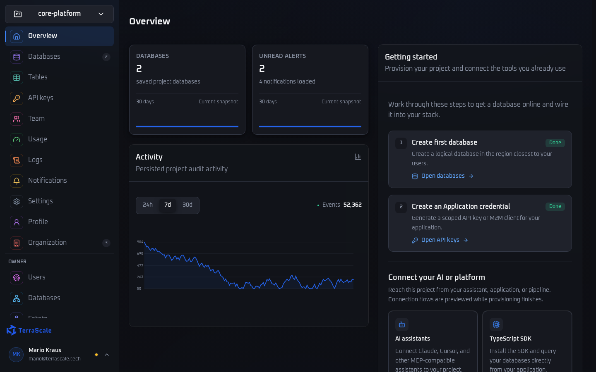
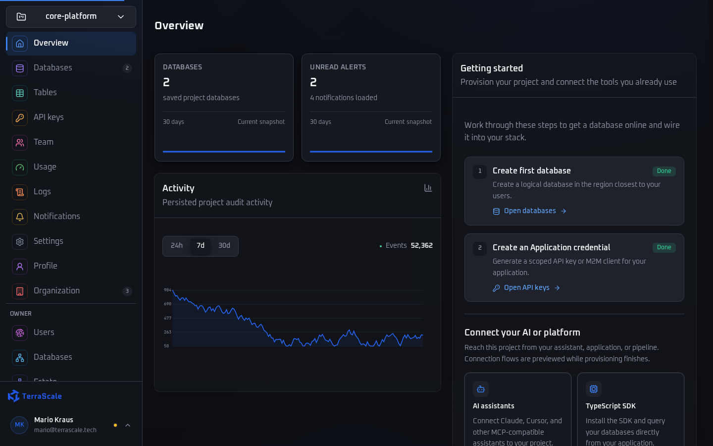
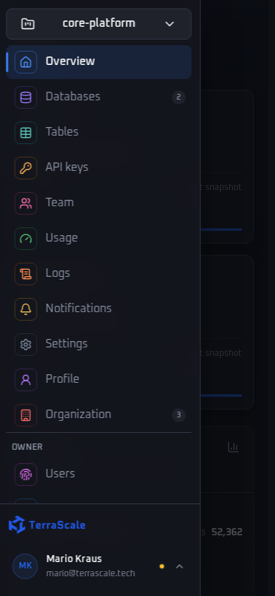

# Measured dashboard comparison

Recorded 2026-09-21 using published Release builds in production demo mode.

- Baseline: `7dfe23999718685df783e2d42a160a799a4d50a3` (origin/main).
- Candidate: `78ba73d243e19dc6d86916d3d78f85e2a6668000` (implementation; subsequent changes document these results).
- Chromium 153.0.8010.12, Playwright 1.63.0, Linux x86_64.
- Five independent contexts per route/profile, each with cold and warm document loads; p75 below. Baseline and candidate ran sequentially.
- Desktop: 1440×900. Mobile: 390×844 and 4× CPU slowdown.
- CDP requested 80 ms latency, 200 KB/s down and 100 KB/s up. Observed loopback TTFB remained roughly 3–5 ms, so these runs do **not** establish realistic mobile network performance.

## Findings

Cold mobile LCP decreased 11–19% across the six routes. Cold transfer bytes decreased 22–87%, primarily from compressed assets and removing the duplicate primary-font request. The map SVG alone is 371,938 bytes uncompressed and 7,398 bytes with Brotli (98% smaller).

Warm navigation is mixed: mobile Usage LCP rose from 372 to 456 ms and desktop Data from 408 to 544 ms. Other warm routes improved or changed slightly. All rows pass the predeclared timing threshold (20% plus 100 ms); this small local sample does not establish a universal warm-load gain. Warm document transfers are slightly larger because of resource hints and navigation metadata. Static resources remain cached.

Candidate CLS rounded to 0.00 for every row. These short synthetic loads do not measure field CLS or INP. The LCP observer runs through font readiness plus a 500 ms settling window; collect field data before making population-level claims. Browser tests separately verify real intent-prefetch consumption, invalidation after mutations, navigation feedback, accessibility fallbacks and scrolling deferred charts.

## Full p75 results

LCP and DOMContentLoaded are milliseconds; transfer is decimal KB including response header estimates. Each cell is **baseline → candidate**. [Machine-readable results](comparison.json) include TTFB, CLS and long-task duration.

| Profile / route / cache | LCP (ms) | DOMContentLoaded (ms) | Transfer (KB) |
| --- | ---: | ---: | ---: |
| desktop /login cold | 324 → 288 | 252 → 155.3 | 450.3 → 57.2 |
| desktop /login warm | 212 → 200 | 30.1 → 27.5 | 2.6 → 2.8 |
| desktop / cold | 336 → 300 | 111.1 → 49.8 | 142.9 → 111.5 |
| desktop / warm | 568 → 384 | 53.1 → 50.8 | 12.8 → 13.1 |
| desktop /databases cold | 440 → 376 | 205.3 → 159 | 514.2 → 118.7 |
| desktop /databases warm | 388 → 404 | 49.2 → 50.9 | 11.8 → 12.6 |
| desktop /data cold | 328 → 292 | 120 → 51.3 | 140.0 → 108.6 |
| desktop /data warm | 408 → 544 | 54.9 → 45.5 | 9.9 → 10.2 |
| desktop /settings cold | 492 → 440 | 90 → 53.1 | 140.4 → 109.1 |
| desktop /settings warm | 840 → 784 | 103.1 → 70.7 | 10.3 → 10.7 |
| desktop /usage cold | 480 → 452 | 170.6 → 63.8 | 149.0 → 117.8 |
| desktop /usage warm | 872 → 808 | 88.4 → 61.9 | 18.9 → 19.3 |
| mobile /login cold | 980 → 876 | 944.2 → 760.1 | 450.3 → 57.2 |
| mobile /login warm | 236 → 268 | 215.7 → 182.7 | 2.6 → 2.8 |
| mobile / cold | 912 → 764 | 829.4 → 684.1 | 142.9 → 111.5 |
| mobile / warm | 356 → 380 | 293.4 → 302.3 | 12.8 → 13.1 |
| mobile /databases cold | 1140 → 988 | 1074.4 → 951.7 | 514.2 → 118.7 |
| mobile /databases warm | 392 → 372 | 272.4 → 279.1 | 11.8 → 12.6 |
| mobile /data cold | 904 → 732 | 816.2 → 661.2 | 140.0 → 108.6 |
| mobile /data warm | 372 → 376 | 265.9 → 274.5 | 9.9 → 10.2 |
| mobile /settings cold | 928 → 788 | 823.2 → 710.5 | 140.4 → 109.1 |
| mobile /settings warm | 452 → 420 | 276 → 279.7 | 10.3 → 10.7 |
| mobile /usage cold | 996 → 848 | 934.6 → 778.4 | 149.0 → 117.8 |
| mobile /usage warm | 372 → 456 | 382.4 → 412.4 | 18.9 → 19.3 |

## Validation

- Release build: zero warnings and errors.
- Fast tests: 29 passed. Slow tests: 97 passed, including the live integration stack.
- Playwright: 19 passed, including eight performance regression checks.
- Formatting, JavaScript syntax, CSS brace balance and diff whitespace checks passed.
- Slow-test build used an isolated committed snapshot of sibling ts-auth to avoid unrelated concurrent edits; this is not a repository dependency change.

## Screenshots

