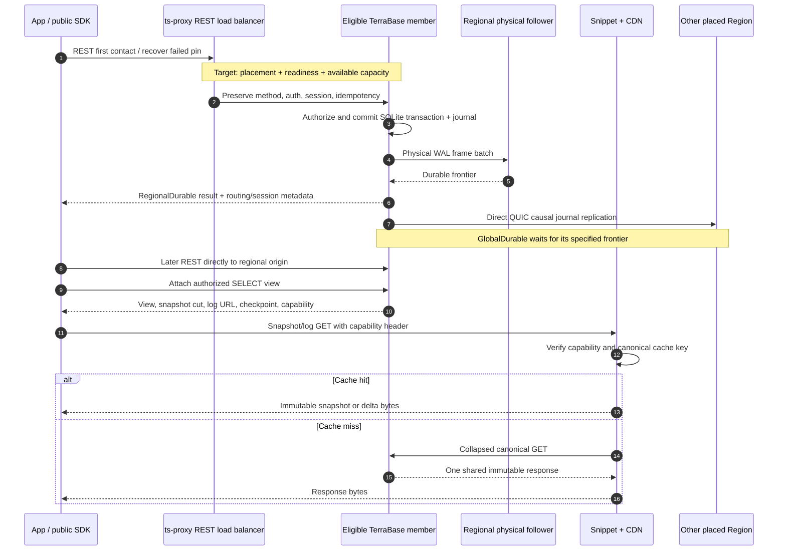
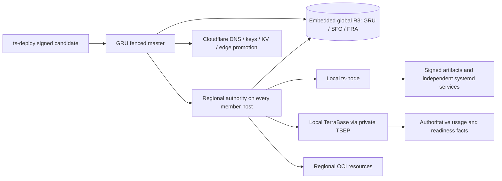

# TerraScale workspace review

TerraScale has a coherent target architecture, but the repositories do not yet
form a qualified production system. The largest gaps are at the connections:
production membership, dashboard persistence and credentials, database route
identity, contract publication, and the health data consumed by routing.
Several strong unit suites pass while those connections remain incomplete.

The owner identified `ts-orchestrator/GOAL.md` as the latest operational design.
The workspace and all eleven repository goals now incorporate its GRU master,
same-host controllers, fixed global R3, greenfield replacement policy, and
Firecracker acceptance requirements. The owner's additional requirements are
part of those goals: `ts-proxy` must balance REST around failed or overloaded
members, and every Region starts with two servers before measured scale-out.

This is a source and local-verification review. It is not a production audit,
a cloud deployment, or proof that the 10/20-Region designs already operate.
Feature proposals below are recommendations; they do not silently enlarge the
accepted launch scope.

## Architecture deliverables

The [architecture atlas](architecture/README.md) contains three rendered
pictures, editable vector sources, and Mermaid detail views:

| Estate | Picture | Editable Mermaid | Initial hosts | Global control replicas |
| --- | --- | --- | ---: | ---: |
| 3 Regions | [SVG](architecture/architecture-3-regions.svg) / [PNG](architecture/architecture-3-regions.png) | [Source](architecture/architecture-3-regions.mmd) | 6 | 3 |
| 10 Regions | [SVG](architecture/architecture-10-regions.svg) / [PNG](architecture/architecture-10-regions.png) | [Source](architecture/architecture-10-regions.mmd) | 20 | 3 |
| 20 Regions | [SVG](architecture/architecture-20-regions.svg) / [PNG](architecture/architecture-20-regions.png) | [Source](architecture/architecture-20-regions.mmd) | 40 | 3 |

These are starting host counts, not capacity limits. Each host runs TerraBase,
a local orchestrator, `ts-node`, and a Grafana agent. GRU, SFO, and FRA each
contain one selected embedded global control-store replica. Further Regions
use those records without joining the global R3. An independent regional R3
requires at least three eligible hosts and explicit admission.

Region labels beyond GRU/SFO/FRA are placeholders, not selected OCI locations.
Adding Regions to the estate does not change a database's immutable placement.
A database placed in three Regions still has RF=2 in those three Regions when
the estate has twenty. There is no twenty-way write or storage multiplier just
because twenty Regions exist.

## Repository ownership

| Repository | Owns | Integrates with | Recommendation |
| --- | --- | --- | --- |
| `terrabase` | Rust engine, SQLite, public REST/reactive API, sync, replication, usage facts, public contracts and private TBEP | SDKs, proxy, local orchestrators, OCI storage | Keep as the single engine/API producer. Complete production composition first. |
| `ts-typescript` | Browser/Node/Worker SDK, React/TanStack adapters, Better Auth adapter | Public member and dashboard product contracts | Keep one customer transport contract. Finish public auth persistence operations. |
| `ts-go` | Go customer SDK | Public HTTP/reactive API | Keep separate from TerraBase's private `terrabase-go` TBEP client. |
| `ts-rust` | Rust customer SDK | Public HTTP/reactive API | Keep it independent of engine internals and SQLite. |
| `ts-dotnet` | .NET customer SDK | Public HTTP/reactive API | Keep .NET here; retire assumptions about a separate .NET gateway. |
| `ts-dashboard` | Vinext Worker, Better Auth, organizations/projects, Stripe, UI/admin, HTTP MCP | Public SDK, control-plane database, proxy binding | Finish the real customer-style persistence journey. |
| `ts-proxy` | REST Worker and reactive Snippet | Member API, placement/health maps, CDN rules/keys | Implement the accepted member/capacity load-balancer contract; preserve Worker-free reactive delivery. |
| `ts-cli` | Go customer CLI, cloud dev branches, schema/codegen, import/export | Public API and Go SDK | Complete default dev workflow; no infrastructure credentials or TBEP. |
| `ts-orchestrator` | Go control plane, OCI/Cloudflare reconciliation, host lifecycle, embedded NATS, `ts-node` | Private TBEP, signed candidates, providers, public estate publication | Keep GRU authority and one local controller per member host. Qualify real composed paths. |
| `ts-deploy` | Go CI/build/check/sign/publish/candidate CLI | All repositories, Forgejo, orchestrator delivery API | Keep rollout state out of CI; align exact compiler outputs and publication tooling. |
| `ts-docs` | Docs, runnable examples, starter, architecture explanations | Published contracts, real sandbox, SDK/CLI | Keep internal reviews outside public site navigation. |

All eleven have a current role. There is no evidence-based reason to archive
one merely because it is small. Simplification should remove duplicate code
and contracts before removing a repository with a distinct runtime or package.

## Request paths

This sequence shows the target. Today the proxy chooses Regions rather than
individual member capacity, and the public view refresh recomputes a full
query. Those differences are findings below, not behavior hidden by the diagram.

The Worker does not decide database authorization or conflict outcomes. The
Snippet checks the capability before access to shared cached data. NATS stores
control intent and receipts, not documents, WAL, query results, reactive data,
or billing truth. The dashboard reads `estate.*` through the same public SDK
used by customers; Grafana Cloud holds collected metrics and logs.

A storage quorum leader is not automatically the application master. Losing
GRU may stop global mutations; it must not stop an already admitted data plane.
Losing one of two member hosts does not itself restore RF=2. Load balancing
must preserve the promised durability level while replacement catches up.

## Integration findings, ordered by impact

### I-01. Production member startup does not compose durable membership

`terrabase/crates/terrabase-server/src/runtime.rs`, `run_production`, returns
`no durable orchestrator membership source is configured` after opening the
catalog/transport. `production.rs` also exposes missing-provider boundaries.
Standalone mode cannot turn unknown replication frontiers into production
readiness.

Complete the durable orchestrator membership source, RF=2/member adapters,
identity, and readiness composition. Then boot the exact production binary in
all six Firecracker guests. Do not remove the refusal merely to make startup
green; it protects against false durability claims.

### I-02. The edge and engine disagree about database identifiers

`ts-proxy/src/placement.ts`, `parseDb`, requires a 26-character ULID and
uppercases it. TerraBase's control database-name validator in
`crates/terrabase-server/src/control.rs` accepts lowercase names of 1–63
letters, digits and dashes. The name is used as the route key.

For example, an engine route for `demo` is rejected by the edge before the
engine sees it. Choose the producer contract's identifier once, distinguish it
from the display name if necessary, and generate validators/KV key handling
for all consumers. Test create → returned ID → proxy → direct member → repair.

### I-03. Dashboard database operations still target legacy project routes

`ts-dashboard/src/backend/database/adapter.ts` calls the root TypeScript
`client.databases`. That client in `ts-typescript/src/client.ts` uses
`/api/v1/projects/{project}/databases`. The newer direct management client in
`src/management.ts` targets TerraBase's `/api/v1/databases` and requires its
placement/body contract.

The engine does not publish the legacy project database routes. Unify the
published operation and DTO, keep project authorization in its owning product
service, and update the dashboard call site. A matching TypeScript interface
is insufficient when the HTTP path/body differs.

### I-04. The production health writer and Worker map contract are separate

`ts-orchestrator/src/orchestrator/cloudflare/kv.go` writes individual Region
entries and database records with fields such as `healthy`, `members`, and
`regions`. `workermaps.go` defines the Worker's actual single `regions` document
and `db:<id>` records with `ok`, `r`, `res`, and timestamps. The production
composition in `cmd/orchestrator/reconcile.go` supplies the older client methods
to `KVWriter`. `declaredKVHealthSource` considers configured addresses healthy;
it does not measure member service health or load.

Wire one exact producer/consumer schema and key layout into the production
writer. Publish observed readiness, drain state and capacity, not configuration
presence. Test the emitted JSON with the Worker parser as well as Go setters.
This is required for the owner's load-balancer behavior.

### I-05. Current routing is not a member/capacity load balancer

`ts-proxy/src/route.ts` selects a Region by location, health and hint;
`src/proxy.ts` forwards to that Region's single hostname. A read network error
can try another Region, but there is no individual member selection or load
input. `healthFilter` returns the original candidates when all are down.
The residency filter also falls back to the unfiltered candidates when its
intersection is empty. These policies do not meet the accepted failover and
immutable-placement requirements.

Select only eligible member endpoints, prefer local alternatives, bound retry
and failure cooldowns, and fail safely when the permitted set is exhausted.
Separate host overload from a tenant quota rejection. Prove client re-entry
when direct regional pins fail; simply adding Worker balancing will not affect
requests that bypass that Worker. Preserve the reactive Snippet/CDN path.

### I-06. Better Auth persistence and the credential bridge are incomplete

`ts-dashboard/src/lib/auth/auth-database.ts` requires an injected operations
binding. `wrangler.jsonc` declares `PROXY` and assets but no concrete auth
operations provider. `ts-typescript/src/better-auth.ts` defines the operations
port but does not supply a published public HTTP implementation for those
atomic persistence semantics.

The member's composed authenticator currently admits its local `KeyStore`
Bearer keys; the runtime seeds a bootstrap key. A separate BYO-JWT module does
not prove that production accepts and distributes dashboard-issued credentials.

Complete the named transaction/unique/CAS/one-time-token operations and the
credential issuer/verification composition. Test concurrent sign-in, revocation,
one-time consumption, and Region movement. The current refusal is not a public
authentication bypass; do not weaken default denial to mask the missing bridge.

### I-07. Contract version strings hide operation drift

At the initial review, the working TerraBase bundle exposed 27 operations,
while committed Go/Rust/CLI and TypeScript metadata pinned 36. Missing producer
routes included index deletion/recommendations, schema get/put, usage, exports,
and webhook management. Dashboard's contract script accepted the bundle despite
that difference because its checks did not establish complete route/hash parity.
The .NET generated catalog also lagged at 35 before regeneration.

The v1 rename preserves unrelated TerraBase route-removal work outside its
commits. Consumers now use the renamed committed 36-operation shape, including
regenerated .NET metadata. That is coordinated naming, not resolution of the
working-tree route gap. Publish one immutable producer bundle and make each
consumer verify its exact digest and full operation descriptor.

### I-08. Public reactive refresh is not yet the incremental target

`terrabase/crates/terrabase-server/src/reactive_api.rs`, `read_log` and
`refresh_view`, take a snapshot, execute the full query, and construct a
remove-all/insert-all update when results change. Shared cached views exist,
but this path does not establish journal-driven incremental view maintenance.
The view-global emission cadence also needs concurrent-reader qualification.

Connect the incremental engine to publication-journal progress and measure
one computation per authorized shared view/cadence window. Test ordered LIMIT
windows, authorization generations, long-poll concurrency, replay, snapshot
cuts and immutable response identity before claiming million-reader economics.
The Snippet already preserves snapshot `cut`; no missing-cut bug was found.

### I-09. The release plan selected the wrong Rust binary, now corrected

`ts-deploy/internal/cli/workflow/develop_release.go` requested `--bin terrabase`
and staged `release/terrabase`. The Cargo package's binary is
`terrabase-server`. The release plan now builds and stages that binary while
retaining the external artifact/component identity. The deployment verification
set passed after this correction.

Also qualify staging when `CARGO_TARGET_DIR` is supplied by the shared runner
cache. Exact artifact paths, signatures, architecture and component names must
be tested together through the actual build and host installation.

### I-10. Installed Forgejo CLI lacks the publication command CI invokes

The local `fj --help` does not provide the `package upload` command used by
`ts-deploy`. This is a local tool compatibility finding, not proof that a remote
runner has the same installation. Pin a supported `fj` capability in runner
provisioning and fail with an actionable diagnostic before release work.
No package publication or production rollout was performed in this review.

### I-11. The default developer journey exposes unfinished contracts

`ts-cli`'s `dev` starts log tail by default and then reports `contract_gap`;
`--no-log-tail` permits the narrower branch-only flow. Seed, watch and some
project/fault options also require unfinished contracts. The starter advertises
seed while acknowledging it is pending. Several SDK tenant/management operations
also return typed contract gaps.

Finish the default happy path before expanding starter/framework coverage.
Test the packed SDK and installed CLI from a clean external project. The SDK
package test now honors the explicitly selected contract bundle rather than
copying arbitrary sibling working-tree contracts.

### I-12. Production qualification is still separate from local green checks

Firecracker, real OCI/Cloudflare behavior, billing reconciliation, restored-data
correctness, residency proofs, million-reader economics, the seven-day soak,
and fourteen consecutive restore drills were not completed by this review.
The orchestrator's portable checks now pass after concurrent host-recovery work
was integrated. That improvement does not certify guest or provider behavior.

Keep real binary digests and scenario results, mark skips, and use the existing
G1–G4 gates. No extra repository or large evidence platform is needed.

### I-13. Human-owned instructions still describe retired architecture

Several SDK/dashboard `AGENTS.md` files retain second-version naming, TQL,
WebSocket-first behavior, or a separate .NET database service. These files were
left untouched as explicitly required. The updated goals state the current
architecture; the owner still needs to reconcile the protected instructions.
The root `AGENTS-RECOMMENDATIONS.md` remains the place for suggested human edits.

## Cleanup and recovery

The active Forgejo organization contains the eleven repositories above. Nine
retired projects were already archived/read-only in `TerraScale-Old`, so no
transfer was necessary: Terrascale.Documentation, Terrascale.Landingpage,
TerraBase, TerraScale.Infrastructure, TerraScale.Deploy, TerraBase.Benchmark,
TerraScale.MCP, TerraScale.Skills, and TerraScale.Database. The archived TerraBase
entry and the active engine belong to different organizations.

Six secondary worktrees were removed after their HEADs were proven ancestors
of pushed `origin/develop`. Useful tracked edits were already merged or were
retired TQL/vector tests. The merged dashboard StyleX branch was removed.
Four obsolete dashboard snapshot copies were also removed from the workspace.

Recovered 103 missing pre-StyleX screenshots into the dashboard's committed
visual baseline folder, preserving twelve existing images. It now contains
115 of 150 expected captures. Thirty-five light-theme captures are still
missing; recovered images are historical references, not evidence that a new
visual comparison passed. The accompanying README records provenance.

The dashboard recovery was committed and pushed, and fifteen existing
TerraBase commits that were ahead of the remote were pushed. A private local
recovery archive is outside the active workspace under
`/home/mariogk/Projects/TerraScale-Old/local-recovery-2026-09-04/`. It contains
source variants and may include private development material; it was not
published. Unrelated main-checkout edits were preserved. Concurrent orchestrator
host-recovery commits were retained rather than overwritten.

## v1 consolidation

Coordinated commits update sync module/class/file names, wire subprotocols,
MessagePack manifests and envelope 1.0, opaque checkpoint markers, engine
storage labels, orchestrator subjects/signature domains, contract hashes and
generated consumers, MCP catalog naming, examples, and documentation.
Unused duplicate helpers and an unreferenced pre-launch delivery fixture were
removed. The retired MCP migration catalog was removed while preserving current
runtime-catalog parity tests.

Post-push verification found and corrected the .NET handwritten HTTP version
check, a Rust hostile-minor expectation, and the .NET operation count. The
TypeScript package qualification now resolves the selected producer bundle
without pulling tooling into the SDK compilation graph.

Real external versions retain their meanings, including NATS imports, Buf
configuration, Linux cgroups, and toolchain/package versions. Negative-version
tests, ordinary second-revision data, protected instructions, Git history,
and archived evidence are not renamed into false positives or false history.
No compatibility shim was added. Disposable development checkpoints/fixtures
need a coordinated reset; no deployed database or cloud state was reset.

## Verification

The owner explicitly required requested commits/pushes before tests, checks or
builds. The initial review results predate that request; subsequent verification
ran after the implementation commits were pushed. Focused corrective commits
were also pushed before their follow-up tests.

| Repository / lane | Initial evidence | Follow-up after v1 work |
| --- | --- | --- |
| `ts-go` | `make check` passed | `make check` passed, including contract verification and race tests |
| `ts-cli` | `make check` passed | `make check` passed; one invocation with an incompatible source environment was corrected |
| `ts-rust` | Format, Clippy, tests passed | Same lanes passed; immutable package acquisition is a separate gate |
| `ts-dotnet` | Release build and 90 tests passed | Release build and all 90 tests passed after HTTP decoder and catalog-count fixes |
| `ts-typescript` | Typecheck passed; 231 tests passed, 3 failed, 10 skipped | Build, typecheck and 234 tests passed with explicit committed 36-operation producer bundle; 10 tests skipped |
| `ts-dashboard` | 167 files / 1,053 tests passed; six formatting failures | MCP slice: 7 files / 54 tests passed, with Vite shutdown warning |
| `ts-proxy` | Typecheck, 115 Worker, 4 production, 35 Snippet, 8 local edge tests, Wrangler dry-run passed | Member/capacity balancing remains an accepted implementation gap, not a new passing claim |
| `terrabase` | `make check` stopped at Clippy's `chunks_exact_to_as_chunks` lint before tests | Sync crate tests passed after v1 correction; full engine/production gates remain separate |
| `ts-orchestrator` | Portable gate initially stopped at preexisting formatting work | Full portable `make check` passed after the concurrent integration and rename |
| `ts-deploy` | `make check` passed | `make check` passed after correcting the Rust binary name |
| `ts-docs` | Site build and 3 stub snippets passed; 4 management snippets skipped | Site build and 3 stub snippets passed; 4 management snippets skipped. Default live test blocked by missing cloud sandbox configuration. All 5 Mermaid graphs rendered; 3 overview pictures inspected |

No Firecracker qualification, live sandbox journey, Stripe billing journey,
production CDN ramp, or deployment was run here. Passing unit and stub results
cannot fill those cells.

## Simplification recommendations

1. Generate one exact operation catalog and ID grammar from TerraBase. Remove
   parallel project/database clients when the real owning route is wired.
2. Use one Worker KV document model in the production writer. Delete the
   obsolete map writer in the same series; keep one schema fixture shared with
   the Worker consumer.
3. Keep one supported sync codec/state machine per language. Generate protocol
   metadata and keep independent hostile byte vectors for verification.
4. Make startup construct concrete adapters in one visible place. Keep narrow
   interfaces for testable dependencies without exporting unwired production
   seams as completed features.
5. Keep the orchestrator tailored to TerraBase. Avoid a generic scheduler,
   provider abstraction framework, or extra control service to solve one
   admission/lifecycle path.
6. Keep `ts-node` as the sole runtime mutator. Remove parallel SSH/systemd
   installers that bypass its signed install and operation journal.
7. Complete and remove the temporary dashboard SQLite bridge at its existing
   deletion gate. Do not migrate its disposable data or grow it into an emulator.
8. Preserve the eleven ownership boundaries for now. Co-locate the Go TBEP
   client with the producer rather than creating another repository for it.
9. Keep one CI program and repository-kind fixtures. Derive output paths from
   the same build inputs rather than copying shell assumptions into each lane.
10. Use one small workspace launcher/check manifest to select existing commands
    and show actual blockers. It should orchestrate existing tools, not become
    another build system.
11. Keep normative goals, design decisions, dated findings, and generated assets
    distinct. Link them instead of copying giant goals into READMEs and skills.
12. Keep one verified visual baseline per route/theme/viewport. Delete captured
    directories after recovery and never approve a StyleX migration by
    regenerating away unexplained differences.
13. Reduce default CLI options until their real public contracts are available,
    or complete them before advertising the default journey. Avoid successful
    setup followed immediately by an expected contract-gap exit.
14. Use existing control-plane documents for admin visibility. Add neither a
    private dashboard transport nor per-tenant Prometheus labels.
15. Require measured demand before adding hosts and admitted placements before
    sending traffic. A global control quorum that grows with every Region adds
    WAN cost and coupling without matching the chosen authority model.

## Prioritized feature and improvement backlog

“Complete” identifies accepted launch work that is not yet qualified.
“New” identifies a recommendation for consideration. Effort is relative:
S is a focused change, M crosses a few modules, L spans repositories or needs
production qualification. This is a planning order, not a delivery estimate.

### Connect and qualify the launch product first

| ID | Proposal | Why / acceptance | Owner | Scope / effort |
| --- | --- | --- | --- | --- |
| F01 | Production composition command | Starts real membership, RF=2, TBEP, API, backup and auth; no successful stubs | Engine + orchestrator | Complete / L |
| F02 | One real sign-in-to-live-query journey | Fresh account creates a DB, writes, and updates two clients | Dashboard + TS + engine | Complete / L |
| F03 | Exact contract fingerprint report | Shows producer/consumer hash and first route/field mismatch | Engine + SDKs + deploy | Complete / M |
| F04 | One generated database-ID validator | Engine, edge, SDK, CLI and KV accept the same identity | Engine + consumers | Complete / M |
| F05 | Public Better Auth persistence | Unique/CAS/one-time-token transactions survive regional races | Engine + TS + dashboard | Complete / L |
| F06 | Credential issuance and revocation journey | Public credentials work on every admitted member and revoke correctly | Dashboard + engine | Complete / L |
| F07 | Member-aware REST load balancing | Failed/draining/overloaded targets are bypassed without widening placement | Proxy + orchestrator + SDKs | Owner requirement / L |
| F08 | Capacity-driven host scaling | Start at two hosts, admit before routing, drain before removal | Orchestrator + engine | Owner requirement / L |
| F09 | Actual incremental public views | Publication journal maintains bounded result deltas without full refresh | Engine | Complete / L |
| F10 | Complete default cloud dev command | Seed, codegen watch, log tail and cleanup work without opt-out flags | CLI + engine + TS | Complete / L |
| F11 | Restore-to-new-database drills | Checksums and journal frontiers prove recovery; failure pages | Engine + orchestrator | Complete / L |
| F12 | Billing replay and reconciliation | Retries/replication/replay yield exact writes and logical byte-seconds | Engine + dashboard | Complete / L |
| F13 | Real six-VM Firecracker qualification | Includes local controllers, R1→R3, fourth-Region admission and cleanup | Orchestrator | Complete / L |
| F14 | Million-reader cost proof | Identical bytes, bounded fills/member resources, zero Worker requests | Edge + engine | Complete / L |
| F15 | Full SDK management parity | Advertised tenant/schema/usage/backup/webhook methods have real routes | Engine + all SDKs | Complete / L |

### Make the product easier to understand and operate

| ID | Proposal | Why / acceptance | Owner | Scope / effort |
| --- | --- | --- | --- | --- |
| F16 | Request-path inspector | Shows first-contact Region, selected member, pin repair and safe request ID | SDKs + dashboard | New / M |
| F17 | Query work inspector | Shows rows/pages examined, selected index and bounded execution cost | Engine + dashboard | Complete refinement / M |
| F18 | “Why is this not subscribable?” diagnostics | Points to the unsupported SQL construct and an equivalent supported query | Engine + SDKs + docs | New / M |
| F19 | Live-view health panel | Distinguishes checkpoint expiry, permission reset, overload and network loss | Dashboard + SDKs | New / M |
| F20 | Shared-view efficiency panel | Shows distinct authorized views, encode rate, cache fills and bytes saved | Engine + dashboard | New / M |
| F21 | Safe redacted diagnostic bundle | Collects versions, route decisions, timings and error codes without payloads | CLI + SDKs | New / M |
| F22 | Database readiness timeline | Explains placement, RF=2, backup, credential and routing gates during creation | Dashboard + engine | New / M |
| F23 | Branch comparison preview | Shows schema/data-summary differences before applying a workflow | CLI + dashboard | New / M |
| F24 | Schema migration preview with work estimate | Reports affected rows/indexes, resumability and expected admission impact | Engine + CLI | Complete refinement / M |
| F25 | One-click automatic index recommendation | Evidence includes benefit, maintenance cost and rollback behavior | Engine + dashboard | Complete / M |
| F26 | Schema-to-SDK preview | Shows the actual generated TS/Go/Rust/C# type diff before `push` | CLI + SDKs | New / M |
| F27 | Parameterized SQL playground | Can execute or attach the same query with actionable bounds/errors | Dashboard + docs | Complete refinement / M |
| F28 | Import dry run | Samples shape/types and estimates write/storage cost without mutation | CLI + engine | New / M |
| F29 | Resumable import progress | Stable import identity survives reconnect without duplicate billing | CLI + engine | Complete refinement / M |
| F30 | Export verifier | Offline CLI validates manifest/checksums without database credentials | CLI | New / S |

### Strengthen reliability without adding services

| ID | Proposal | Why / acceptance | Owner | Scope / effort |
| --- | --- | --- | --- | --- |
| F31 | Observed health contract fixture | The Go publisher's exact bytes are consumed by the real Worker parser | Orchestrator + proxy | Complete refinement / M |
| F32 | Load-balancer probation and hysteresis | Recovered members re-enter gradually without bouncing traffic | Proxy + orchestrator | New / M |
| F33 | Capacity forecast by Region | Warns before saturation using workload trend and replacement time | Orchestrator + dashboard | New / M |
| F34 | Dry-run scale plan | Displays which databases move, RF=2 headroom and the cost change | Orchestrator | New / M |
| F35 | Replication frontier debugger | Explains which frontier prevents a session read or durability acknowledgement | Engine + dashboard | New / M |
| F36 | Dependency-queue age alerts | Bounded Region metrics distinguish missing causal context from transport delay | Engine + observability | New / M |
| F37 | Residency proof explorer | Displays allowed regions for files, backups, exports and branches | Engine + dashboard | Complete refinement / M |
| F38 | Backup freshness and restore-time estimate | Exposes backup RPO separately from RF=2 durability | Engine + dashboard | New / M |
| F39 | Release inventory and rollback preview | Shows exact digests per host and whether rollback preserves contract skew | Orchestrator + dashboard | New / M |
| F40 | Artifact path/architecture integration fixture | Actual compiler output is signed, installed and health-checked in a guest | Deploy + orchestrator | Complete refinement / M |
| F41 | Control recovery rehearsal | Restore snapshots without epoch regression or competing masters | Orchestrator | Complete / L |
| F42 | Region admission checklist in CLI output | Identity, capacity, backup, placement and probe gates are independently visible | Orchestrator | Complete refinement / M |
| F43 | Failure-in-the-middle test campaign | Crash during bootstrap, placement, scale and rollout, then resume receipts | Orchestrator + engine | Complete / L |
| F44 | Bounded contract-skew policy | Declares which producer/SDK/control digests may coexist during rollout | Engine + deploy + orchestrator | Complete / M |
| F45 | Key-generation adoption view | Shows which consumers accepted the next key before retiring the old one | Orchestrator + dashboard | New / M |

### Reinforce writes-and-storage pricing

| ID | Proposal | Why / acceptance | Owner | Scope / effort |
| --- | --- | --- | --- | --- |
| F46 | Pre-write billing estimate | Shows units by canonical size and selected Regions before bulk ingestion | SDKs + dashboard | New / M |
| F47 | Live Region price multiplier | Explains the exact write/storage change during database setup | Dashboard | Complete refinement / S |
| F48 | History retention calculator | Shows storage impact of per-collection retention using actual byte-seconds | Dashboard + engine | New / M |
| F49 | Branch allowance meter | Separates shared development allowance from production plan use | Dashboard + engine | Complete refinement / M |
| F50 | Spend-cap race qualification | Concurrent regional writes cannot silently bypass the stated cap semantics | Engine + dashboard | Complete / L |
| F51 | Free-dimension guard explainer | States the limit, cause and recovery time; never converts it into a bill | SDKs + docs | Complete refinement / S |
| F52 | Billing receipt drill-down | Customer can trace a billed period to bounded engine usage facts | Dashboard + engine | New / M |
| F53 | Reaper preview and recovery UI | Makes 30-day pause, 90-day deletion and paid exemptions clear | Dashboard + orchestrator | Complete refinement / M |
| F54 | Measured margin worksheet | Separates direct reads, CDN fills, replication, views and fixed estate cost | Deploy + docs + engine | Complete / M |
| F55 | Growth cost comparison | Compares adding a host, moving an eligible DB and splitting a hot workload | Dashboard + orchestrator | New / M |

### Expand developer workflows after the core journey works

| ID | Proposal | Why / acceptance | Owner | Scope / effort |
| --- | --- | --- | --- | --- |
| F56 | SDK error links to exact docs | Stable error codes resolve to runnable fixes without generic support advice | SDKs + docs | New / S |
| F57 | Cross-language cookbook | The same schema, write, query and subscription run in all four SDKs | Docs + SDKs | New / M |
| F58 | Interactive conflict examples | Demonstrates concurrent regional writes and the actual merge winner/history | Docs + engine | New / M |
| F59 | Scoped MCP mutation tools | Named public operations, live authorization and audit; no private bypass | Dashboard | Complete / L |
| F60 | MCP query explanation tool | Helps agents understand query bounds/index recommendations before execution | Dashboard + engine | New / M |
| F61 | SDK diagnostics callbacks | Applications observe retry/pin/reset events without intercepting raw headers | SDKs | New / M |
| F62 | Checkpoint lifecycle examples | Shows correct reconnect, expiry reset and permission shrink handling | Docs + SDKs | New / S |
| F63 | Webhook replay console | Bounded replay with stable delivery identity and visible destination errors | Dashboard + engine | New / M |
| F64 | Schema-aware fixtures generator | Produces reproducible synthetic datasets without copying customer data | CLI | New / M |
| F65 | Accessibility regression lane | Exercises keyboard, focus, contrast and screen-reader labels on key journeys | Dashboard | New / M |
| F66 | Complete light/dark visual baseline | Recovers remaining 35 references and qualifies fixed viewports without hiding diffs | Dashboard | Complete / M |
| F67 | TypeScript server functions | Follow the already chosen first post-launch direction; choose runtime by ADR | Engine + orchestrator + TS | Accepted post-launch / L |
| F68 | Read-only persistent result cache | Offline reads with explicit expiry/revocation rules before any offline writes | SDKs | Accepted post-launch / L |
| F69 | More starter/framework integrations | Add React/Vite, Expo and deployment integrations after Next is reliable | Docs + TS | Accepted post-launch / M |
| F70 | Controlled Region expansion pilot | Qualify the fourth Region, then 10/20-region scale, latency and recovery budgets | Orchestrator + engine + edge | Expansion / L |

I would start F01–F07 together at their contract boundaries, then use the real
journey as the acceptance test for F09–F15. Complete exact contract/KV identity
before introducing routing policy. F16–F30 improve the product once the user
can reliably reach it. Treat F67–F70 as later work; they should not become a
reason to postpone the current three-Region launch gates.

## Suggested owner decisions

Keep the current eleven repositories. Keep the regional two-host starting
point and fixed global R3. Require measured capacity/latency thresholds before
autoscaling policy is enabled. Choose and publish the one database-identity
contract, control RPO/RTO and supported release skew. Reconcile the human-owned
instructions. Retain the existing launch feature scope unless the owner chooses
to reduce it; this review does not delete promised product features to make a
gate appear green.

## Final delivery evidence

All eleven repositories had HEAD equal to `origin/develop`, one primary worktree,
and no staged changes at the final inventory. Unrelated working edits remained
in their original repositories. The review and architecture atlas were committed
and pushed to `ts-docs`; workspace goals are also preserved as explicitly labeled
review-time snapshots in `workspace-goals-2026-09-04/`.

The default docs live gate was attempted and refused missing sandbox URL, API
key and database ID. The explicitly selected stub lane passed independently;
it is not a substitute for the cloud gate. Temporary migration source exports
were removed after qualification; the private recovery archive was retained.
